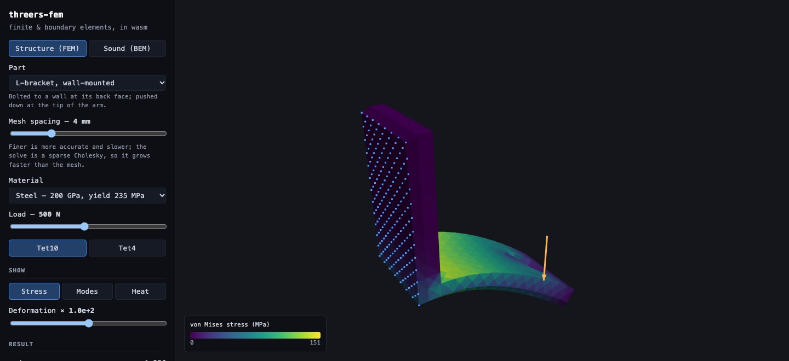
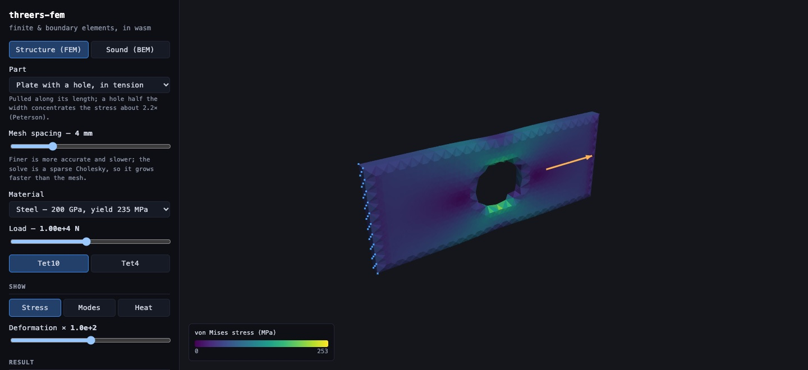
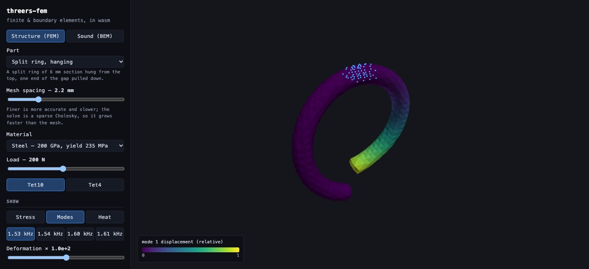
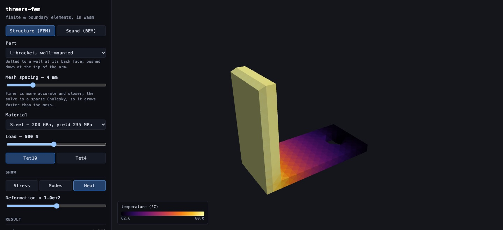
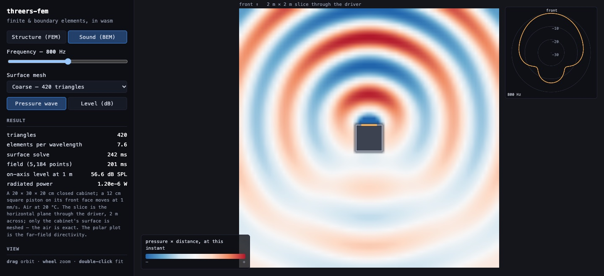

# threers-fem

Finite and boundary element analysis for [threers](https://github.com/eugenehp/threers):
a tetrahedral mesher, linear elasticity, heat conduction and modal analysis
(FEM), and potential problems and acoustics (BEM). Pure Rust, wasm-ready, no
dependencies beyond `threers` itself (without its renderer).



```toml
[dependencies]
threers-fem = "0.1.0"
```

```rust
use threers_fem::{Elastic, Material, TetMesh};

// A steel cantilever, 100 × 10 × 10 mm, in mm / N / MPa.
let mesh = TetMesh::box_grid([0.0; 3], [100.0, 10.0, 10.0], [20, 2, 2]);
let s = Elastic::new(&mesh, Material::new(200e3, 0.3))
    .fix(|p| p[0] < 1e-9)
    .force(|p| p[0] > 100.0 - 1e-9, [0.0, -100.0, 0.0])
    .solve()?;
println!("tip {:.3} mm, peak {:.0} MPa", s.max_displacement(), s.max_von_mises());
```

## What is in it

| | |
|---|---|
| `TetMesh::from_geometry` / `from_sdf` | Isosurface stuffing on a body-centred cubic lattice: any closed `BufferGeometry` or signed distance function to tetrahedra, every boundary node on the surface. Sharp edges are bevelled by a fraction of the spacing. `TetMesh::box_grid` is exact for boxes. |
| `Elastic` | Linear elasticity on four- or ten-node tetrahedra (ten by default; four lock in bending). Isotropic or full anisotropic stiffness — a homogenised lattice's `Stiffness::c` goes straight in. Clamps, rollers, prescribed displacement, forces, tractions, pressure, gravity. Stress, von Mises, reactions, strain energy. |
| `Elastic::modes` | Natural frequencies and mode shapes by shift-invert subspace iteration; free parts give their six rigid modes at zero. |
| `Heat` | Steady conduction: fixed temperatures, flux, convection, sources, anisotropic conductivity. Also electric potential, diffusion, seepage. |
| `fem::voxel` | A matrix-free voxel solver for brick meshes of any closed mesh. |
| `bem::Laplace` | Potential problems inside or outside a closed surface, mixed boundary conditions: capacitance, electrostatics, potential flow. |
| `bem::Helmholtz` | Exterior acoustics: radiation from a vibrating surface and scattering by a rigid body, with CHIEF against irregular frequencies; far field, sound power, SPL. |
| `plot` | Results as coloured, optionally deformed `BufferGeometry` to draw. |

Every element integral is exact (straight-sided elements, barycentric
polynomials); the tests check the elements against patch tests, beam theory,
conduction in slabs and spheres, and the BEM against analytic spheres,
including rigid-sphere scattering against the series solution.

Linear systems are solved by sparse Cholesky after nested dissection, or by
Jacobi-preconditioned conjugate gradients when the factor would be too large
or too slow; BEM systems are dense, so keep surfaces to a few thousand
triangles.

| | |
|---|---|
|  |  |
| Stress concentration beside a hole half the plate's width | The first natural mode of a split ring hung from its top |
|  |  |
| Steady conduction: held at 80 °C at the wall, cooled by still air | BEM: a cabinet's pressure wave at 800 Hz and its directivity, with no mesh of the air |

The full guide — meshing, every analysis, solver costs, the bindings, how
it is tested and its limits — is [docs/fem.md](https://github.com/eugenehp/threers/blob/main/docs/fem.md).

## In the browser, Python and Node

The same API — supports and loads placed by axis-aligned boxes, results as
flat arrays — is bound three ways, all over `threers_fem::flat`:

| | Build | Names |
|---|---|---|
| JavaScript (wasm) | `crates/threers-fem/build-web.sh` → `web/pkg-fem/` (feature `wasm`) | `FemModel`, `FemSurface`, camelCase |
| Python | `threers` wheel, feature `fem` (on in the published wheel) | `threers.FemModel`, `threers.FemSurface`, snake_case |
| Node | `threers-node`, feature `fem` (on in `npm run build`) | `FemModel`, `FemSurface`, camelCase, `Float64Array` results |

```python
import threers
m = threers.FemModel.shape("bracket", 4.0)       # or FemModel.from_triangles(...)
m.set_material(200e3, 0.3, 7.85e-9)              # steel, mm / N / MPa
m.fix_box((-1, -1, -1), (0, 51, 31))
m.force_box((60, -1, -1), (61, 7, 31), (0, -500, 0))
print(m.solve().max_von_mises, m.modes(3).frequencies)
```

**Web demo:** `crates/threers-fem/build-web.sh`, then
`python3 -m http.server --directory web 8080` and open
<http://localhost:8080/fem/> — four parts under load (stress, mode shapes,
heat), and a loudspeaker cabinet's sound field and directivity by BEM.

## Examples

```sh
cargo run --release -p threers-fem --example fem_bracket   # stress and modes of an L-bracket
cargo run --release -p threers-fem --example bem_speaker   # a loudspeaker cabinet's sound field
```

## Feature flags

| Flag | Effect |
|---|---|
| `parallel` | Assembly, BEM matrices and field evaluation across threads via rayon. Native only. |
