# Examples

Every example that draws something, with the picture it draws. Each was
produced by running the command beside it on a headless wgpu device — the
same code path a CI job or a server would use, no window and no display.

Images are 640 px JPEGs regenerated from the examples themselves; they live
in [`docs/images/`](images/) and are excluded from the published crate.

74 of them. The rest of the examples are interactive (winit), export
video rather than a frame, or print numbers — see [`examples/`](../examples/).

| | |
|---|---|
| <a href="images/backend_parity.jpg">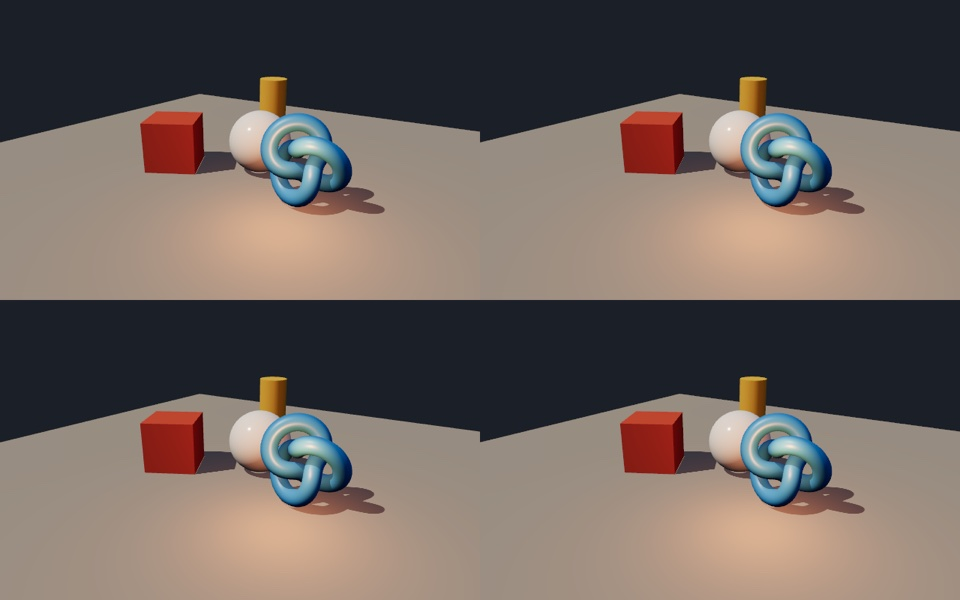</a> | **`backend_parity`** One scene through every renderer: wgpu natively and threers' own Metal renderer (top), and the same scene from `web/examples/parity.html` in Chrome on WebGPU and on WebGL2 (bottom). Mean difference from the wgpu frame: Metal 0.01, WebGPU 0.09, WebGL2 0.003 levels of 255.  `cargo run --release --features metal --example backend_parity`  4 renderers; the browser half is `web/examples/parity.html` |
| <a href="images/campfire.jpg">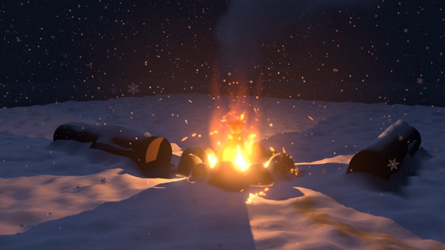</a> | **`campfire`** A campfire on a snowy night: black-body flame, embers, sparks, smoke that cools, shades itself and casts a shadow, and heat haze; its glow drives a flickering point light over drifted, glittering snow. Through bloom and ACES.  `cargo run --release --example campfire` |
| <a href="images/captions_render.jpg">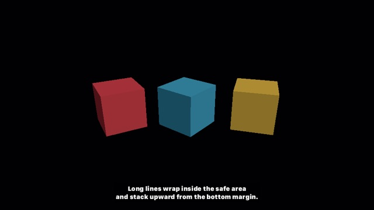</a> | **`captions_render`** Captions over a 3D render, both ways: composited on the GPU by the renderer's overlay pass, and painted on the CPU into an RGBA buffer.  `cargo run --release --example captions_render`  5 images; the largest is shown |
| <a href="images/cuboct.jpg">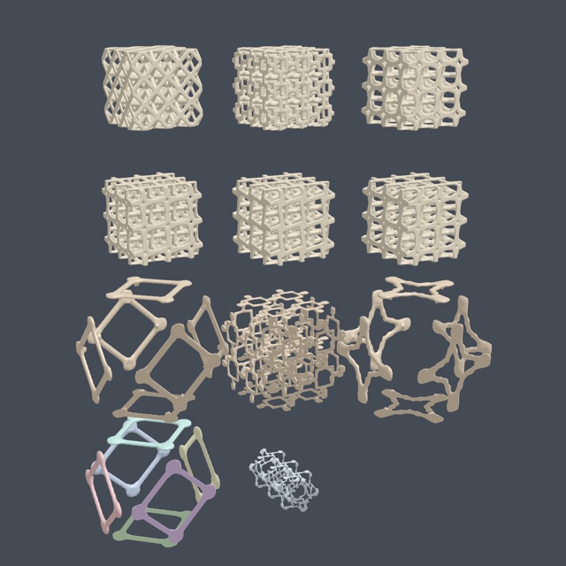</a> | **`cuboct`** Face-connected cuboct voxels (Jenett et al., Sci. Adv. 2020).  `cargo run --release --example cuboct` |
| <a href="images/data_charts.jpg">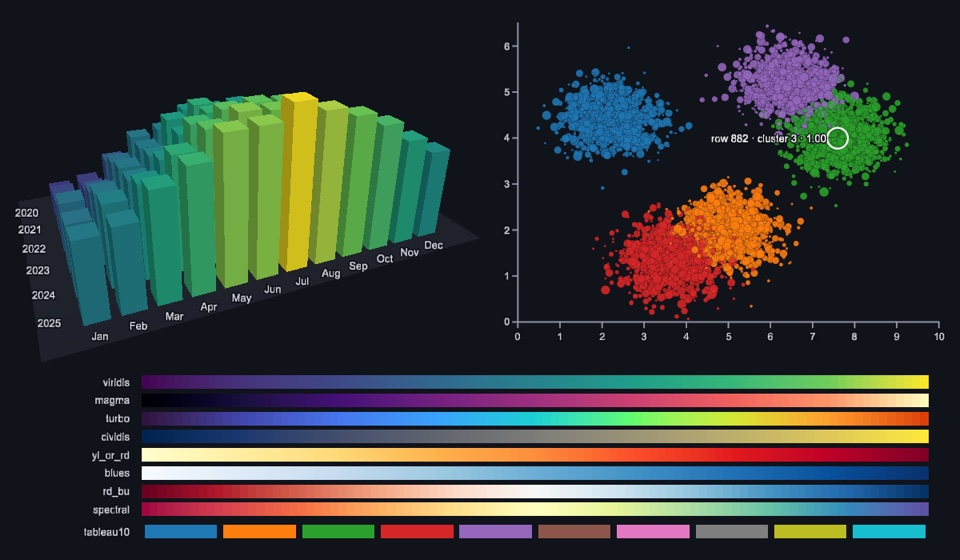</a> | **`data_charts`** Charts from `threers::marks` with no map: a 3D bar chart on a sequential colour scale, six thousand points in five categories with one picked on the GPU and called out, and the named colour ramps and a categorical palette.  `cargo run --release --features captions --example data_charts` |
| <a href="images/denoise_ab.jpg">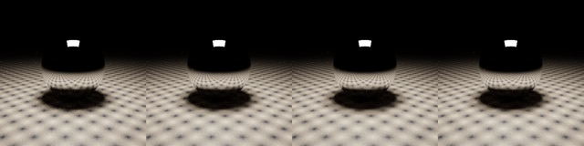</a> | **`denoise_ab`** Visual A/B of À-Trous widths: fitted albedo gate vs a restored tight one.  `cargo run --release --features raytrace --example denoise_ab`  10 images; the largest is shown |
| <a href="images/denoise_compare.jpg">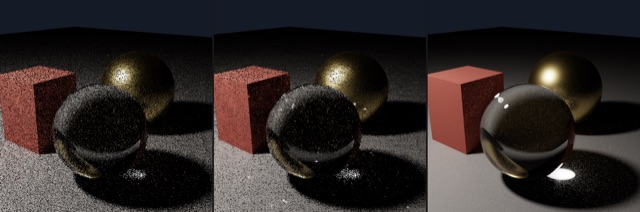</a> | **`denoise_compare`** One scene, four ways: raw, À-Trous, a trained network, and the reference.  `cargo run --release --features raytrace --example denoise_compare`  4 images; the largest is shown |
| <a href="images/dunes.jpg">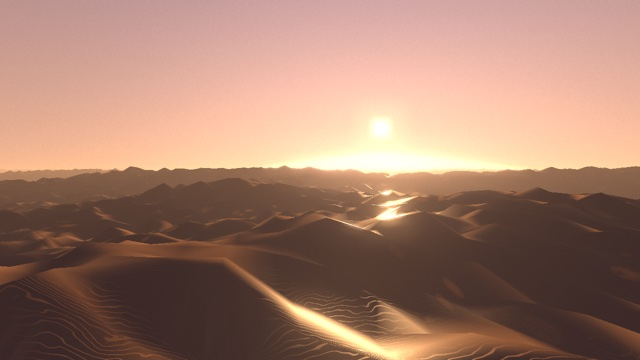</a> | **`dunes`** A kilometre of sand dunes grown procedurally and worked by the wind into slip faces at 34°, shaded after Journey's sand (grains, ripples, an anisotropic sheen along the wind, glitter), sand smoking off the crests, under a sky the haze meets without a seam — at dawn, day, sunset and night.  `cargo run --release --example dunes` |
| <a href="images/earth_sun_flare.jpg">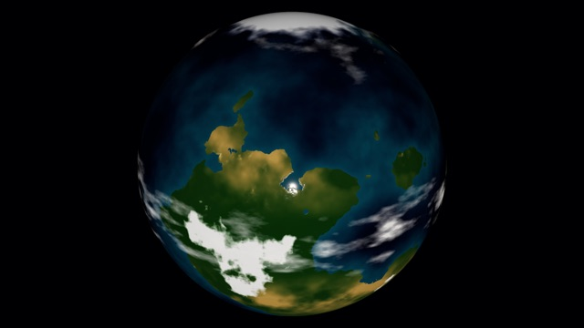</a> | **`earth_sun_flare`** Earth lit by the sun, with a lens flare — a full PBR scene from procedural high-resolution textures, no asset downloads.  `cargo run --release --example earth_sun_flare`  3 images; the largest is shown |
| <a href="images/fluid3d.jpg">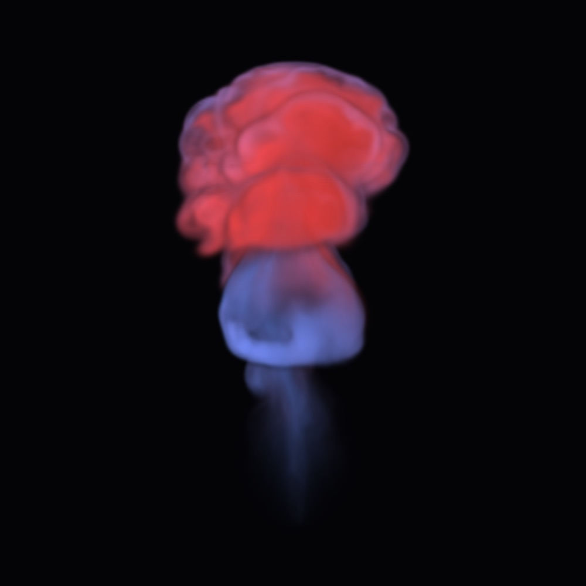</a> | **`fluid3d`** A three-dimensional fluid: a rising plume of coloured smoke, ray-marched through a volume packed into a 2D texture.  `cargo run --release --features fluid --example fluid3d` |
| <a href="images/fluid_render.jpg">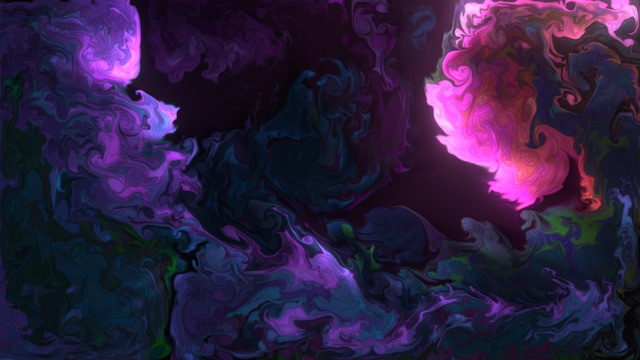</a> | **`fluid_render`** An interactive 2D fluid, driven by a script instead of a hand: four strokes drawn across the canvas and then left to curl for a second.  `cargo run --release --features fluid --example fluid_render`  2 images; the largest is shown |
| <a href="images/fur.jpg">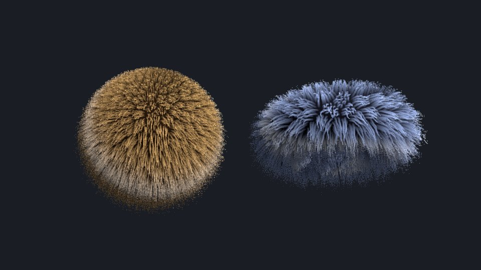</a> | **`fur`** Shell fur on a ball and a torus: a short drooping coat and long, curly, clumped tufts, lit by a sun whose shadows the fur casts.  `cargo run --release --example fur` |
| <a href="images/fur_closeup.jpg">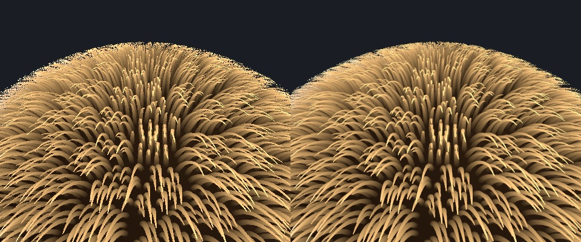</a> | **`fur_closeup`** Fur a hand's width away, one sample beside 4× MSAA: each shell sweeps its strands across its slab so a strand stays one column, and MSAA tests every sample against the strands.  `cargo run --release --example fur_closeup` |
| <a href="images/fur_motion.jpg">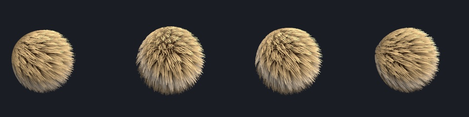</a> | **`fur_motion`** A furry ball that sets off, brakes and stops in a light wind; its coat trails, swings forward and settles (`FurAnimator`).  `cargo run --release --example fur_motion` |
| <a href="images/fur_stroke.jpg">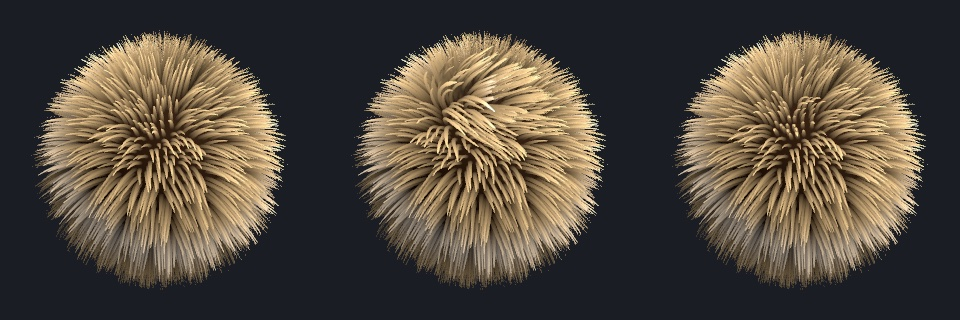</a> | **`fur_stroke`** A hand in the coat (`FurAnimator::stroke`): before, while it sweeps across, and half a second after it lets go.  `cargo run --release --example fur_stroke` |
| <a href="images/glass_modes.jpg">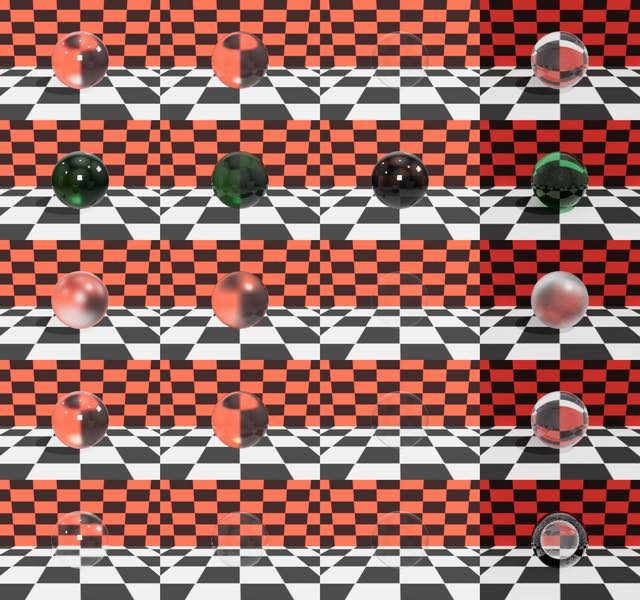</a> | **`glass_modes`** Every way threers draws glass, beside the path tracer: three.js transmission, screen-space refraction and thin glass, for clear, tinted, frosted, dispersive and thin-walled balls under a shadowing sun.  `cargo run --release --features raytrace --example glass_modes` |
| <a href="images/gummy.jpg">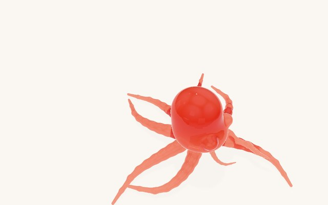</a> | **`gummy`** A gummy jellyfish (or `--octopus`) on `threers::softbody`: held at rest, pulled by a tentacle until it tears, then left to start growing back — refracting gel, gonads inside, fringe, goo. Drawn by the wgpu renderer and, with `--features metal`, threers' Metal renderer (1.4 levels of 255 apart). The same creatures in the browser: `web/examples/jelly.html`.  `cargo run --release --example gummy --features metal` |
| <a href="images/hair.jpg">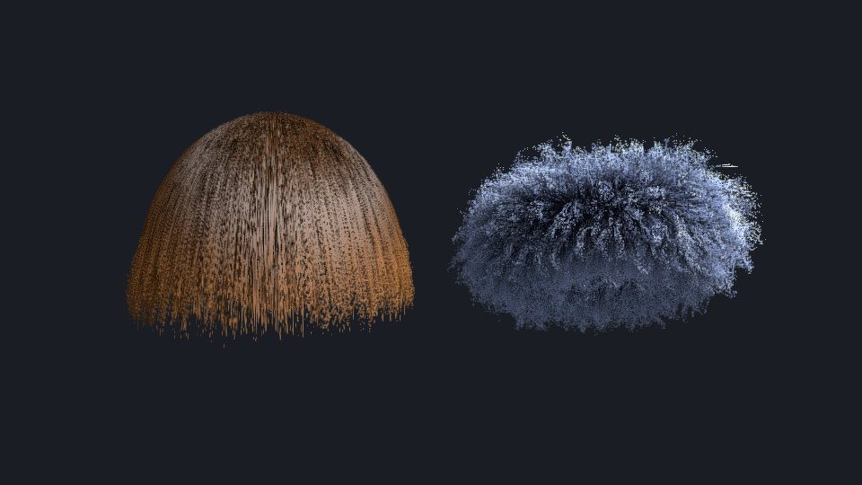</a> | **`hair`** Strand hair: a head of long hair hanging under gravity, and a curly, clumped mane on a torus.  `cargo run --release --example hair` |
| <a href="images/hdri_lighting.jpg">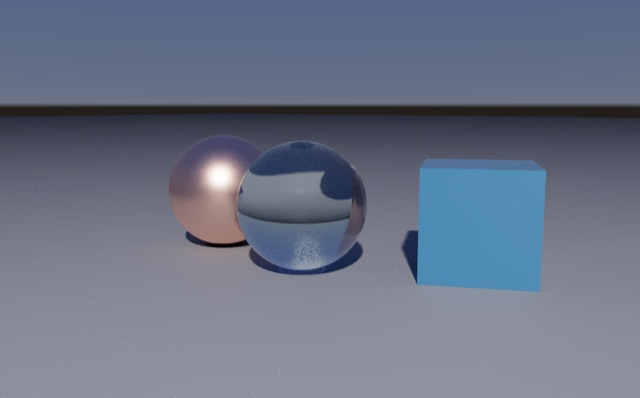</a> | **`hdri_lighting`** Image-based lighting: one HDRI, no lights at all.  `cargo run --release --features raytrace --example hdri_lighting` |
| <a href="images/ik_servo_demo.jpg">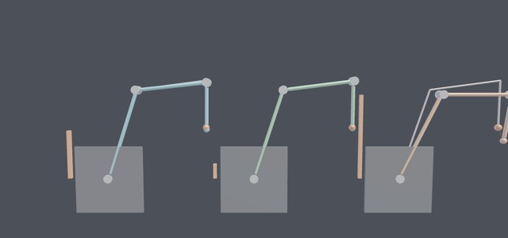</a> | **`ik_servo_demo`** Visual demo: three identical arms track the same IK path under different transmissions — direct drive, QDD (15:1), and a high-ratio servo (288:1).  `cargo run --release --example ik_servo_demo`  6 images; the largest is shown |
| <a href="images/kirigami.jpg">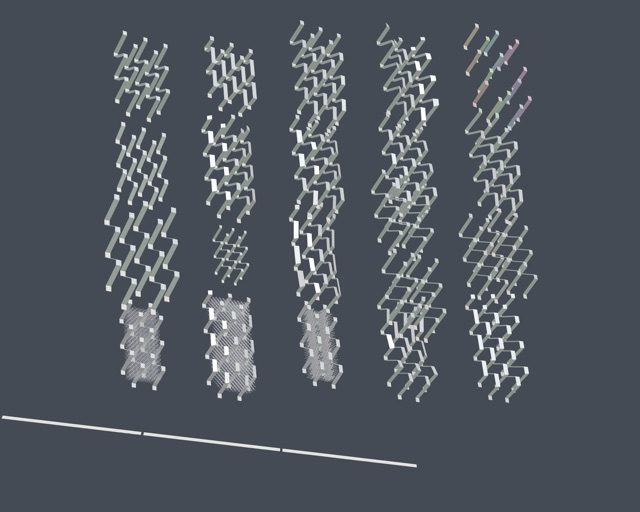</a> | **`kirigami`** Kirigami Expanded Miura — gallery of folded states, plus crease-pattern nets.  `cargo run --release --example kirigami` |
| <a href="images/lattice.jpg">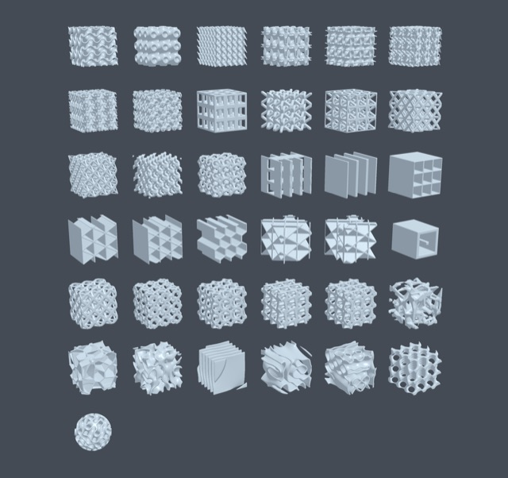</a> | **`lattice`** Every lattice generator, rendered headless to a PNG.  `cargo run --release --example lattice` |
| <a href="images/lattice_engineering.jpg">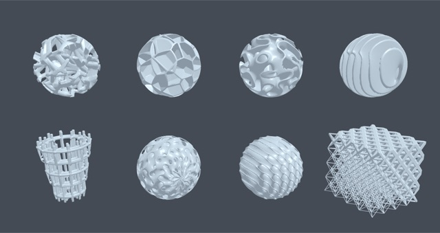</a> | **`lattice_engineering`** Lattices as engineering, not decoration: foams, conformal cells, a field-driven grade, and the numbers that come out of all of it.  `cargo run --release --example lattice_engineering` |
| <a href="images/lattice_foams.jpg">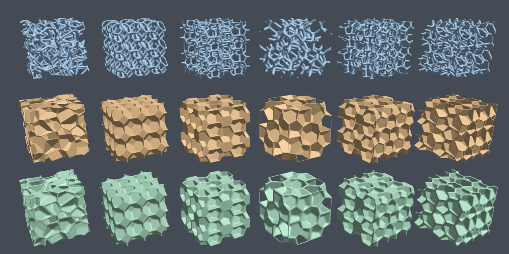</a> | **`lattice_foams`** Voronoi foams on every kind of seed — random, the Kelvin, Weaire–Phelan and C15 crystals, Lloyd-relaxed and two-size — each as an open foam, a closed foam and a wet foam with Plateau borders, all fitted to a density.  `cargo run --release --example lattice_foams` |
| <a href="images/lattice_print.jpg">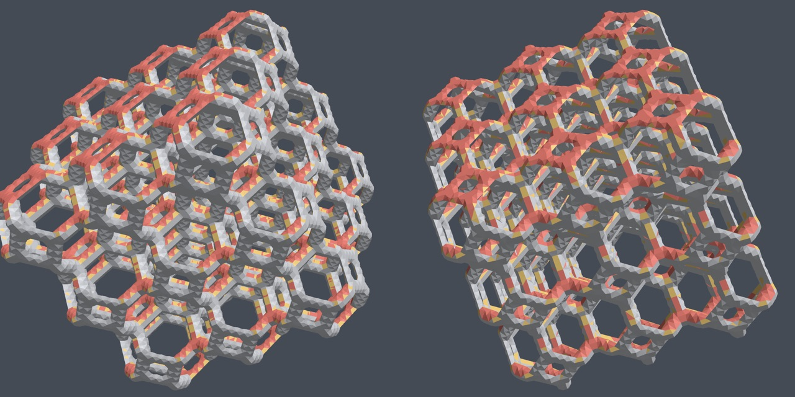</a> | **`lattice_print`** Getting a lattice ready to print: a Kelvin foam checked with `utils::mesh_check` (closed, triangle quality, pieces, support area and footprint) and simplified with `utils::simplify`, shown from below with every overhang a 45° process must support in red — as built on the left, at a third of the triangles on the right.  `cargo run --release --example lattice_print` |
| <a href="images/lattice_shapes.jpg">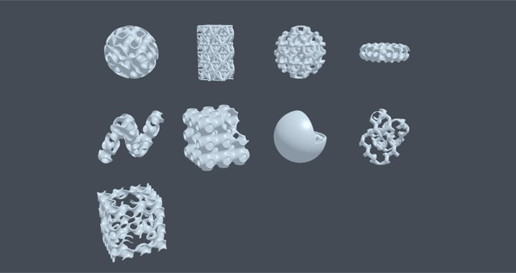</a> | **`lattice_shapes`** Lattices poured into shapes rather than boxes, rendered headless to a PNG.  `cargo run --release --example lattice_shapes` |
| <a href="images/lattice_textiles.jpg">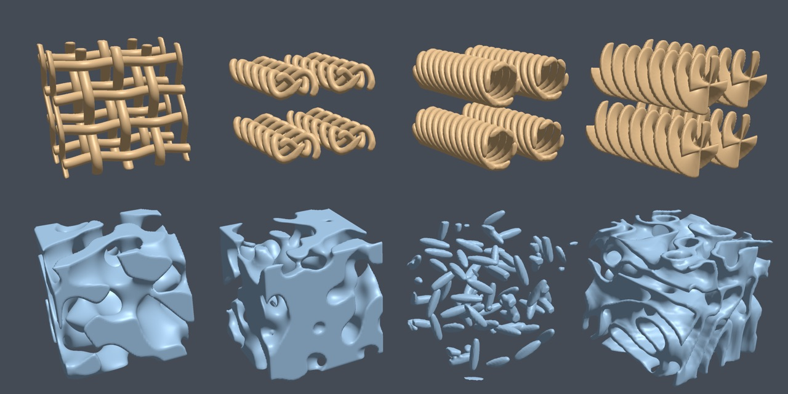</a> | **`lattice_textiles`** Yarn and grain: a plain weave, a three-strand braid, a six-fibre rope and helicoid screws, then a spinodal beside a broadband Gaussian field, hyperuniform fibres and a Gray–Scott reaction–diffusion maze.  `cargo run --release --example lattice_textiles` |
| <a href="images/map_demo.jpg">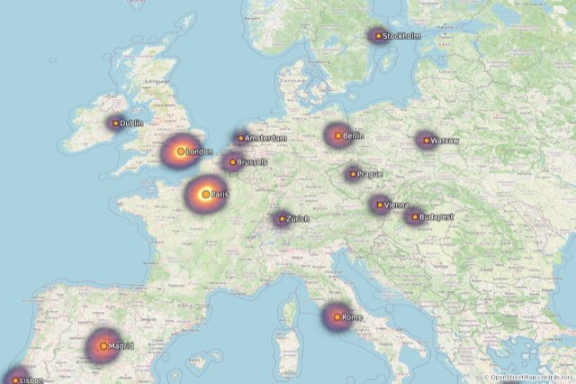</a> | **`map_demo`** A small map on `threers::marks`: OpenStreetMap raster tiles fetched in the background and cached on disk (any `--tiles URL` template, or `--tiles none` offline), European cities as pin-and-name symbols in multi-channel distance-field text, and an auto-scaled heatmap. Driven by `MapView`; `--png` renders the frame shown. Map tiles © OpenStreetMap contributors.  `cargo run --release --example map_demo --features captions -- --png map_demo.png` |
| <a href="images/marks_map.jpg">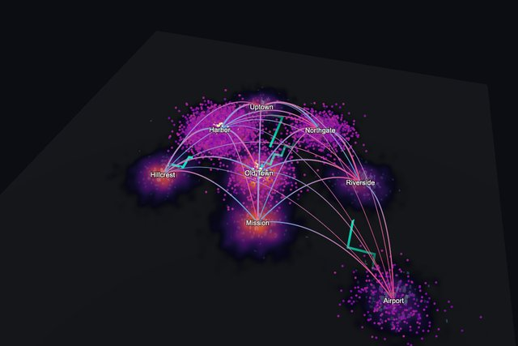</a> | **`marks_map`** A kepler.gl-style map from `threers::marks`: twenty thousand pickups thirteen million metres from the origin as a heatmap, as points filtered by hour on the GPU, as animated trips (a hook over mitred polylines), arcs and labels, among seven hundred extruded buildings drawn in one `PolygonMarks` call. Interactive with `MapControls` and hover picking; `--png` renders the frame shown.  `cargo run --release --example marks_map -- --png marks_map.png` |
| <a href="images/material_chart.jpg">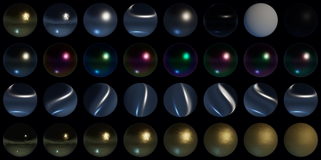</a> | **`material_chart`** Headless contact sheet of the spacecraft material presets and the extended PBR layers, rendered to a PNG.  `cargo run --release --example material_chart`  2 images; the largest is shown |
| <a href="images/metal_headless.jpg">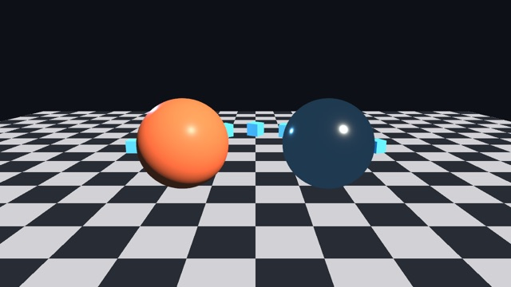</a> | **`metal_headless`** Offscreen rendering through the Metal backend.  `cargo run --release --features metal --example metal_headless` |
| <a href="images/metal_stereo.jpg">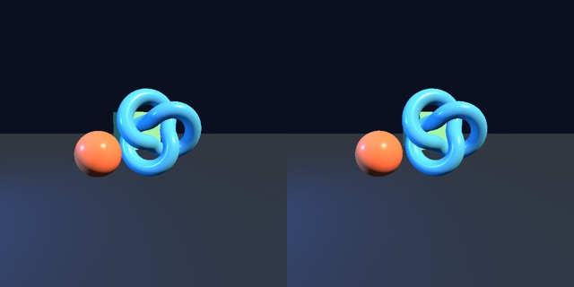</a> | **`metal_stereo`** Stereo rendering through the Metal backend — the visionOS frame shape, offscreen so it can be run on a Mac.  `cargo run --release --features metal --example metal_stereo` |
| <a href="images/nema17.jpg">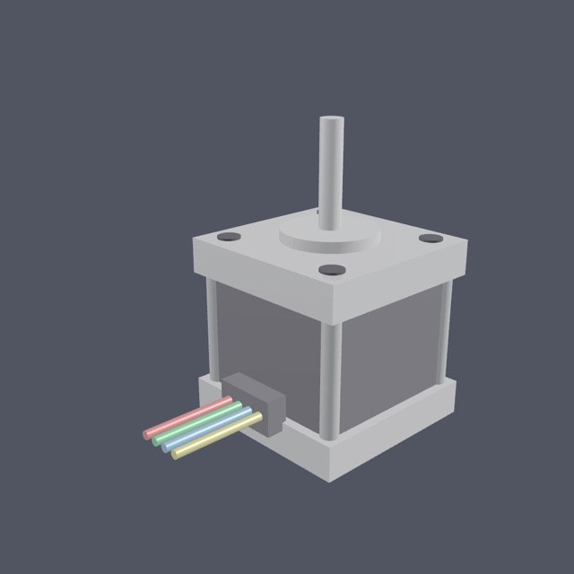</a> | **`nema17`** Detailed **NEMA 17 stepper motor** — a single-part assembly shown on its own.  `cargo run --release --features openscad --example nema17` |
| <a href="images/neon_logo.jpg">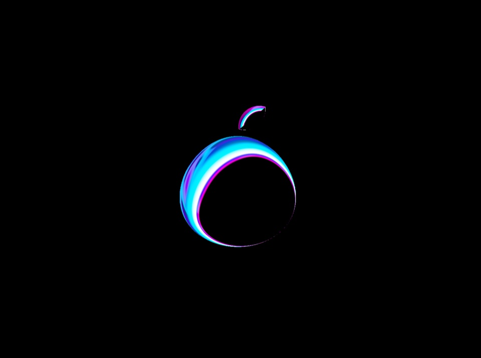</a> | **`neon_logo`** An iridescent mark: black metal under a drifting neon field, lit so that almost all of it reads as silhouette and only the rim carries colour — a noise wash under a ten-stop ramp on the half-Lambert term, swept from 2D outlines into inflated solids. Shown with the neutral mark (`NEON_MARK=drop`).  `NEON_MARK=drop cargo run --release --example neon_logo` |
| <a href="images/ocean_water.jpg">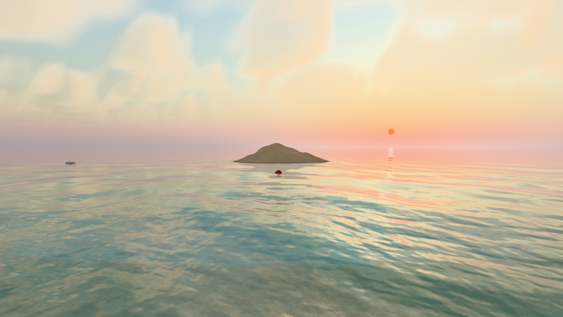</a> | **`ocean_water`** A spectral ocean: JONSWAP waves inverse-transformed on the GPU into three cascades, foam, absorption and a Preetham sky, at sunset. Interactive without `--png`.  `cargo run --release --example ocean_water -- sunset --png ocean.png` |
| <a href="images/openscad_gallery.jpg">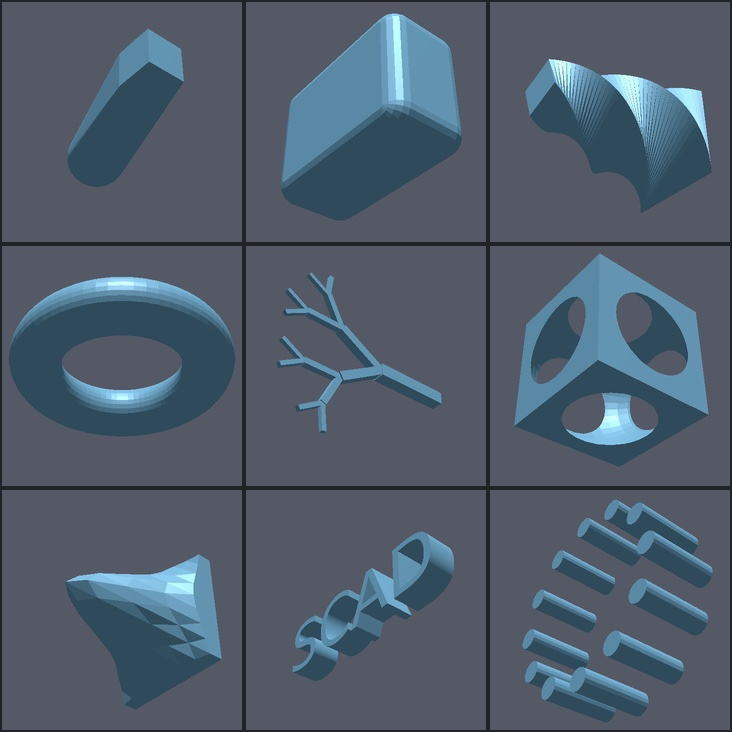</a> | **`openscad_gallery`** The OpenSCAD front end's breadth: 37 `.scad` snippets (hulls, Minkowski sums, twisted extrusions, recursion, text, heightfields) evaluated by the exact kernel, written as STL and rendered.  `cargo run --release --features openscad --example openscad_gallery -- out/openscad-gallery --png`  9 of its 37 thumbnails |
| <a href="images/openscad_render.jpg">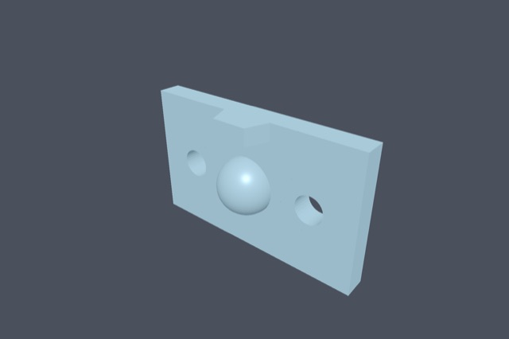</a> | **`openscad_render`** Headless render of the OpenSCAD-style `Solid` front end → PNG, so you can *see* it working end-to-end (`--features openscad`).  `cargo run --release --features openscad --example openscad_render` |
| <a href="images/origami.jpg">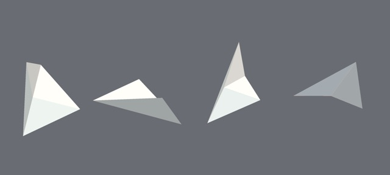</a> | **`origami`** Figure 1 of arXiv:1812.01160 — a single degree-4 vertex, two rigid modes.  `cargo run --release --example origami` |
| <a href="images/origami_gallery.jpg">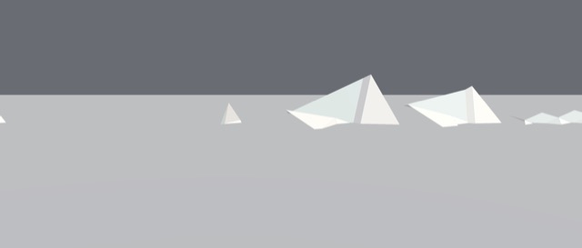</a> | **`origami_gallery`** Contact sheet of rigid-origami gadgets.  `cargo run --release --example origami_gallery` |
| <a href="images/origami_miura.jpg">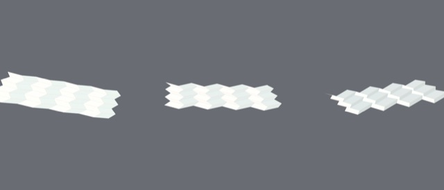</a> | **`origami_miura`** Miura-ori tessellation — a rigidly foldable sheet from a seed mode.  `cargo run --release --example origami_miura` |
| <a href="images/origami_twist.jpg">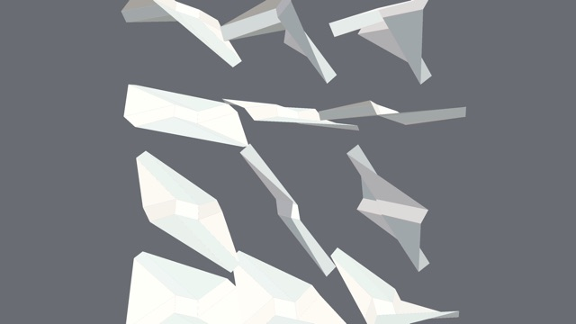</a> | **`origami_twist`** Square twist — Lemma 14 of arXiv:1812.01160.  `cargo run --release --example origami_twist` |
| <a href="images/particles.jpg">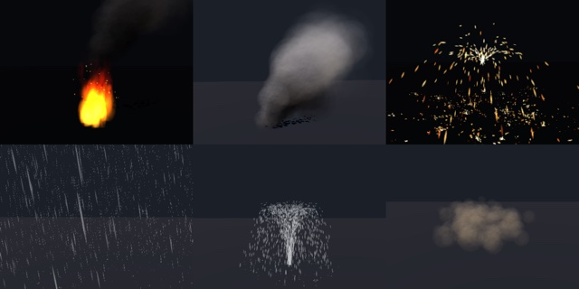</a> | **`particles`** The particle presets: a campfire, smoke and sparks; rain, a fountain and a puff of dust — quadratic drag, divergence-free turbulence, buoyancy and collisions.  `cargo run --release --example particles` |
| <a href="images/path_trace.jpg">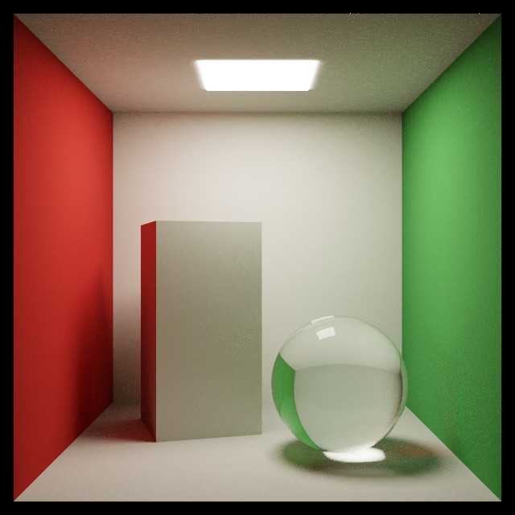</a> | **`path_trace`** A Cornell box, path traced.  `cargo run --release --features raytrace --example path_trace`  8 images; the largest is shown |
| <a href="images/path_trace_gpu.jpg">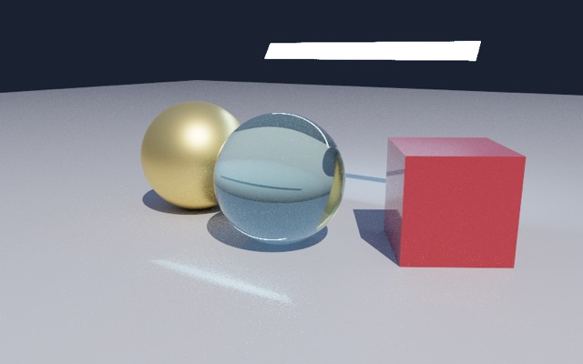</a> | **`path_trace_gpu`** The same path tracer on the GPU, timed against the CPU.  `cargo run --release --features raytrace --example path_trace_gpu`  2 images; the largest is shown |
| <a href="images/pole_probe.jpg">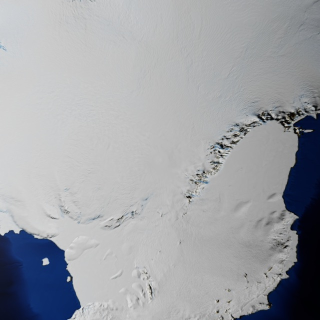</a> | **`pole_probe`** Renders the north pole from the real NASA maps, one contributing map at a time, so the polar fan can be attributed to a specific one.  `cargo run --release --features planet --example pole_probe`  10 images; the largest is shown |
| <a href="images/postfx_chain.jpg">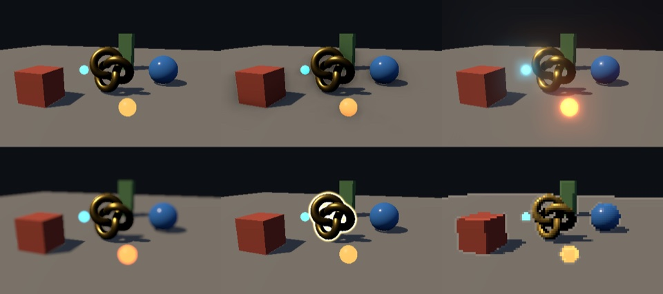</a> | **`postfx_chain`** `EffectComposer` natively, one scene six ways: as rendered, SSAO, bloom, depth of field, a selection outline and a pixel-art pass.  `cargo run --release --example postfx_chain` |
| <a href="images/printer_assembly.jpg">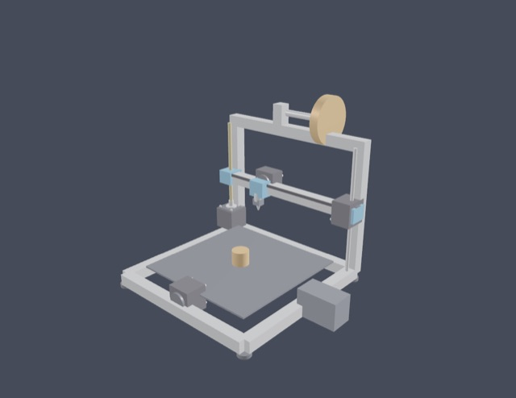</a> | **`printer_assembly`** Parametric Cartesian **3D printer assembly** — with NEMA 17 stepper motors.  `cargo run --release --features openscad --example printer_assembly` |
| <a href="images/progressive_denoise.jpg">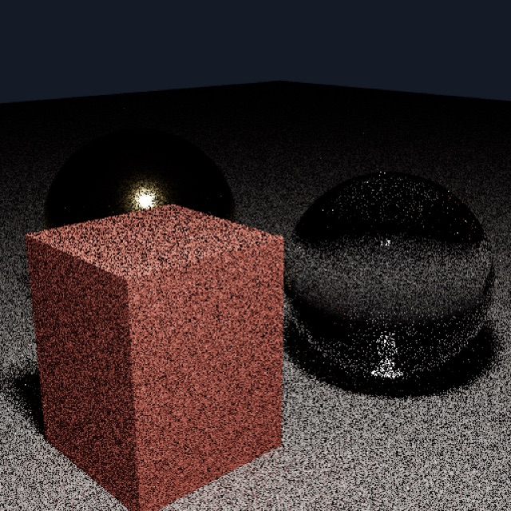</a> | **`progressive_denoise`** **Progressive path tracing with the denoiser in the loop** — write a frame after each batch of samples, denoised, so the image is usable long before…  `cargo run --release --features raytrace --example progressive_denoise`  64 images; the largest is shown |
| <a href="images/quad_view.jpg">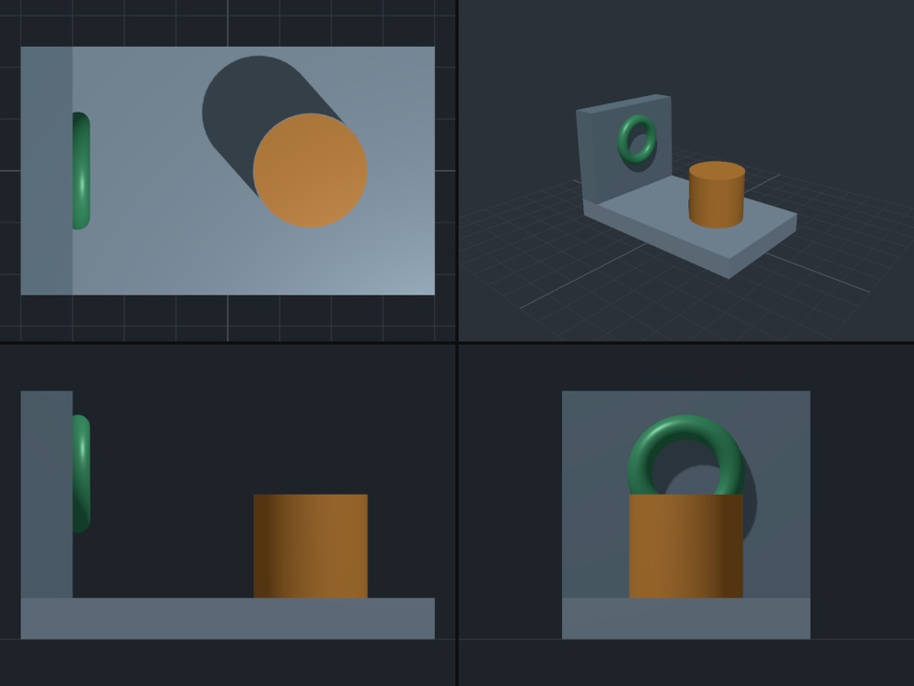</a> | **`quad_view`** One canvas, four panes: top, front and side orthographic views at one shared scale beside a perspective view, CAD-style. `--max front\|top\|side\|persp` renders one pane maximised.  `cargo run --release --example quad_view -- out/quad_view.png` |
| <a href="images/raspberry.jpg">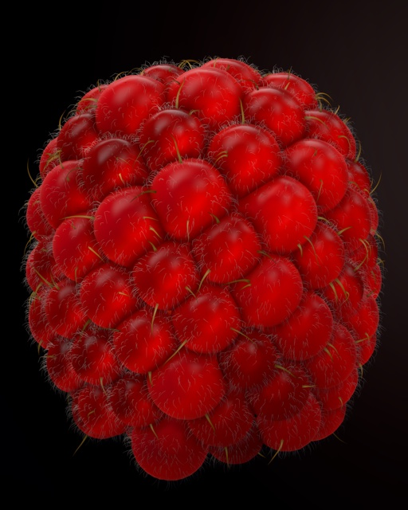</a> | **`raspberry`** A raspberry built out of 117 translucent drupelets, dried styles and forty-eight thousand hairs, lit by three soft boxes and nothing else.  `cargo run --release --example raspberry` |
|  | **`realistic_earth`** A realistic Earth from NASA imagery, in about a hundred lines of setup.  `cargo run --release --features planet --example realistic_earth` |
|  | **`retrofuturism`** A scene rebuilt number for number from the file it was authored in: an orthographic frame, a sunset seen through reeded glass bars, layered materials, and type cropped at the frame edge as the original's is. Shown revealed — as saved, a black card hides the sunset, which is how the source looks too.  `cargo run --release --features captions --example retrofuturism`  `out/retrofuturism_revealed.png`; the frame as saved is the other output |
|  | **`rlx_conv_postfx`** Post-processing as compiled rlx graphs (`--features rlx`).  `cargo run --release --features rlx --example rlx_conv_postfx`  6 images; the largest is shown |
|  | **`rlx_fit_grade`** Learn a colour grade from a reference, by gradient descent (`--features rlx`).  `cargo run --release --features rlx --example rlx_fit_grade`  5 images; the largest is shown |
|  | **`rlx_frame_filter`** Run an RLX graph over a rendered frame (`--features rlx`).  `cargo run --release --features rlx --example rlx_frame_filter`  2 images; the largest is shown |
|  | **`rlx_geo_erosion`** Terrain diffusion as an iterated graph (`--features rlx,rlx-geo`).  `cargo run --release --features rlx,rlx-geo --example rlx_geo_erosion`  2 images; the largest is shown |
|  | **`rlx_geo_materials`** Voronoi cells as material maps (`--features rlx-geo`).  `cargo run --release --features rlx-geo --example rlx_geo_materials`  4 images; the largest is shown |
|  | **`rlx_geo_refine`** Adaptive Delaunay refinement, against a uniform grid (`--features rlx-geo`).  `cargo run --release --features rlx-geo --example rlx_geo_refine`  2 images; the largest is shown |
|  | **`rlx_geo_terrain`** Exact Delaunay and Voronoi through `rlx-geo` (`--features rlx-geo`).  `cargo run --release --features rlx-geo --example rlx_geo_terrain`  2 images; the largest is shown |
|  | **`rlx_mesh_smooth`** Mesh smoothing as a graph over the positions tensor (`--features rlx`).  `cargo run --release --features rlx --example rlx_mesh_smooth`  3 images; the largest is shown |
|  | **`rlx_palette`** Palette extraction, and a mosaic built from it (`--features rlx,rlx-geo`).  `cargo run --release --features rlx,rlx-geo --example rlx_palette`  4 images; the largest is shown |
|  | **`sand`** Sand poured into a cone at its angle of repose, 34°, at 5 s and 30 s; and dunes grown by Werner's slab model from a flat sheet under a steady wind.  `cargo run --release --example sand` |
|  | **`scad_profile`** Where a SCAD animation's time goes.  `cargo run --release --features openscad --example scad_profile` |
|  | **`shadow_types`** The four shadow filters on one scene: `Basic`, `Pcf`, `PcfSoft` and `Pcss`, which is sharp where each object meets the ground and softens with distance from it.  `cargo run --release --example shadow_types` |
|  | **`simcity_render`** A procedurally generated city seen from the air, mid-morning: deterministic from a seed, in five street layouts, at any time of day (`--time`, `--strip`), or as a whole day encoded to WebM by the pure-Rust codecs (`--anim`).  `cargo run --release --example simcity_render` |
|  | **`skinned_animation`** Skinning and the animation mixer: three tentacles on chains of eight bones sway in one clip and cross-fade into a second that curls them.  `cargo run --release --example skinned_animation` |
|  | **`snow`** Snow settling on sheds and a post, sliding off roofs and drifted by the wind: a time-lapse at 7 s, 16 s and 50 s.  `cargo run --release --example snow` |
|  | **`spacecraft_render`** Headless PNG render of the same spacecraft as `spacecraft_materials`, for machines with no display (CI, servers, remote boxes).  `cargo run --release --example spacecraft_render`  2 images; the largest is shown |
|  | **`starfield_probe`** What the sky sphere does to point sources.  `cargo run --release --features planet --example starfield_probe`  10 images; the largest is shown |
|  | **`svg_gallery`** The cases that are hard for a vector renderer, as SVG: interpenetrating shapes, a camera inside the scene, a floor behind it, receding walls, an orthographic view.  `cargo run --example svg_gallery`  9 SVGs, rasterized side by side |
|  | **`time_smear`** Echoes in time (`threers::time_smear`): a ball crossing the frame, an orbiting dot, and a box that is only there for frames 70–85 yet echoes before it appears; the backdrop never moves and comes back byte for byte. Rows: source, faithful, ghost, raw, echo. Drawn by the wgpu renderer or, with `--features metal -- --metal`, the Metal renderer — the same backdrop value from both. In the browser: `web/examples/time-smear.html`.  `cargo run --release --example time_smear` |
|  | **`tower_collapse`** Rigid bodies from `threers-physics`, rendered: a heavy ball thrown into a Jenga-style tower of 36 planks, which comes down and settles.  `cargo run --release -p threers-physics --example tower_collapse` |
|  | **`ui_panel`** `threers::ui`: a control panel written in CSS terms with Chrome's form controls, laid out, hit-tested and painted over a render; a simulated click on the slider sets the roughness the knot is drawn with.  `cargo run --release --features ui --example ui_panel` |
|  | **`usd_stage`** A USD stage, composed: a piece defined once as a `class`, placed three times by reference, with a variant set swapping its `UsdPreviewSurface` material; the last panel after a round trip through threers' `.usdz` writer.  `cargo run --release --features usd --example usd_stage` |
|  | **`venom_button`** A glossy black button that hunts for the pointer: a `threers::fx` `Button` wearing `Venom`. Strands of goo feel toward the cartoon glove, lunge and grab it finger by finger while the goo creeps over the hand, then stretch, snap and slump back with spikes and droplets. One smooth-unioned distance field per pixel, shaded as black lacquer. Interactive without `--png`; `--look chrome\|gold\|toxic` restyles it.  `cargo run --release --example venom_button -- --png out/venom`  5 frames; the hold, cropped to the button |
|  | **`venom_gallery`** The same style on anything: a pill, a circle, a star and an SVG heart wearing `Venom` in four looks, a card and a badge wearing `Gloss`, on one `Stage`, each venom caught by its own scripted hand in a different moment. The captions are a component written in the example. Interactive without `--png`.  `cargo run --release --example venom_gallery -- --png out/venom_gallery.png` |
|  | **`viewport_path_trace`** Interactive viewport-style path tracing: rebuild the scene only when it changes, reuse the BVH across camera moves, and resolve progressive frames.  `cargo run --release --features raytrace --example viewport_path_trace`  2 images; the largest is shown |
|  | **`volume_slices`** A 3D Shepp–Logan head phantom: axial, coronal, sagittal and oblique cross-sections drawn on the GPU by `SliceRenderer` (a window/level ramp with a label volume blended over it), then its surfaces by `MarchingCubes` — the skull cut open, and the segmented structures in the slices' colours.  `cargo run --release --example volume_slices` |
