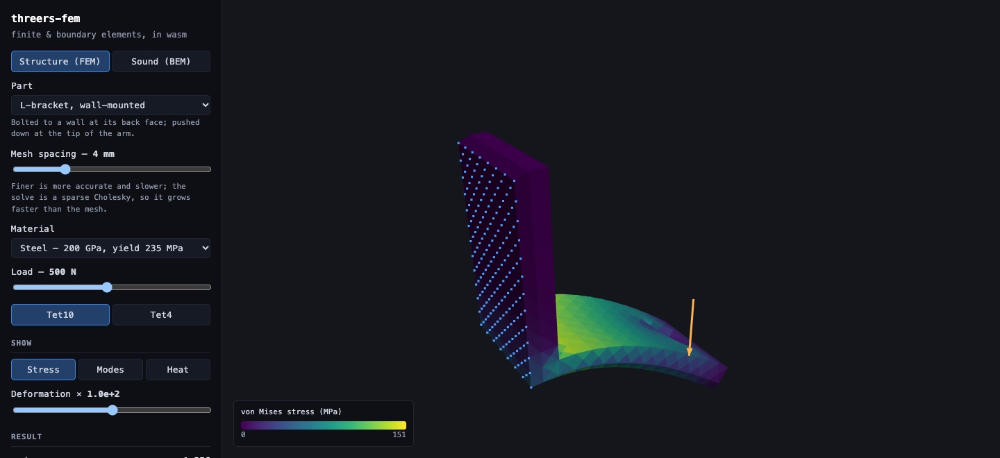
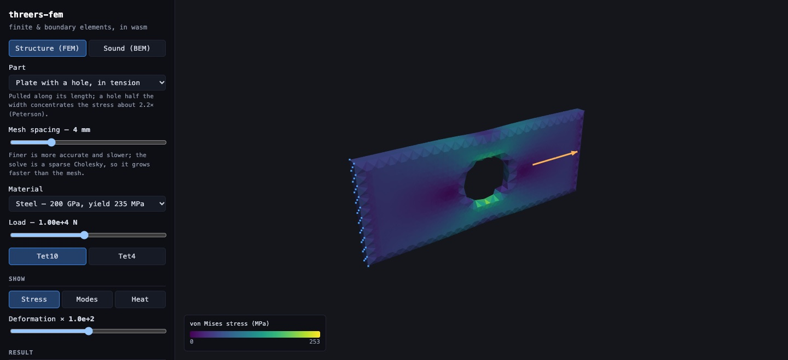
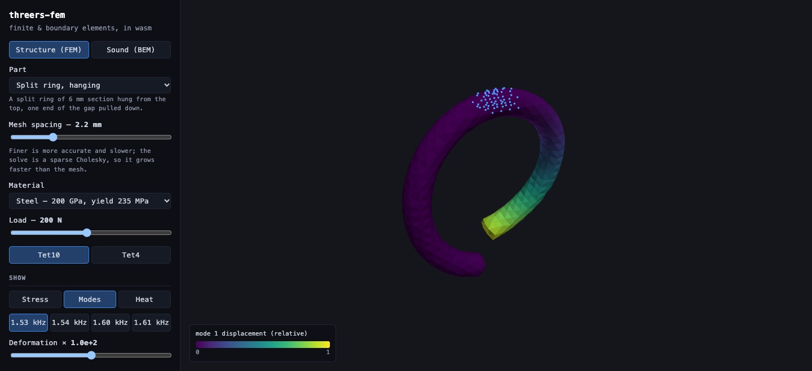
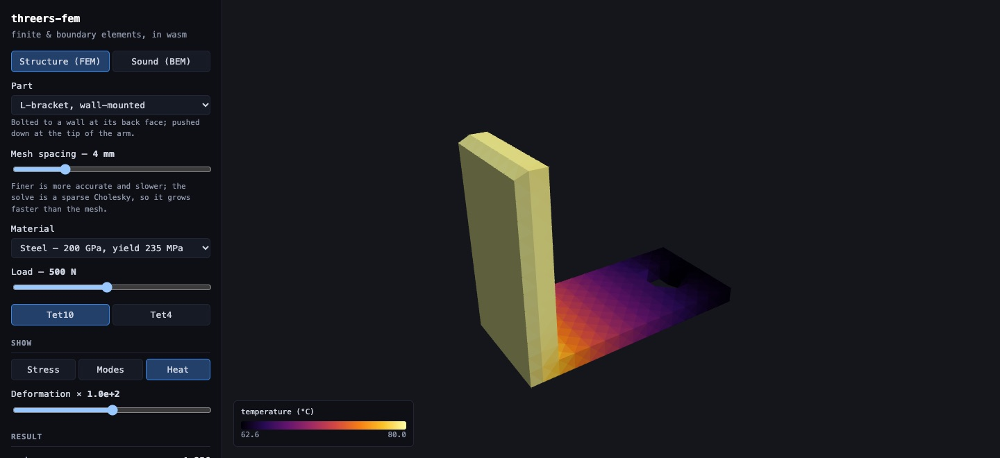
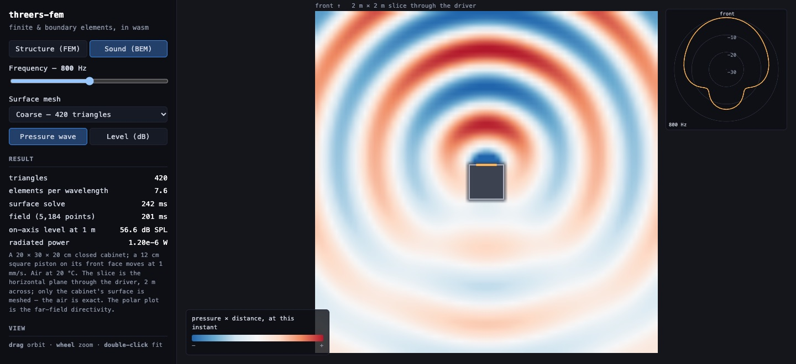

# Finite and boundary elements

Part of the [threers](../README.md) documentation.

Structural, thermal and acoustic analysis live in the companion crate
[`threers-fem`](../crates/threers-fem), a workspace member. It meshes any
closed `BufferGeometry` or signed distance function into tetrahedra and
solves on them by the **finite element method** — stress, natural
frequencies, temperature — and solves potential and acoustic problems on a
surface alone by the **boundary element method**. Pure Rust, no dependencies
beyond `threers` (without its renderer), and it runs in the browser.

```toml
[dependencies]
threers = "0.1.0"
threers-fem = "0.1.0"
```



- [Which method](#which-method)
- [Quick start](#quick-start)
- [Meshing](#meshing)
- [Elasticity](#elasticity)
- [Natural frequencies](#natural-frequencies)
- [Heat](#heat)
- [Voxel elasticity](#voxel-elasticity)
- [Linear solvers and cost](#linear-solvers-and-cost)
- [Boundary elements: potential problems](#boundary-elements-potential-problems)
- [Boundary elements: acoustics](#boundary-elements-acoustics)
- [Drawing results](#drawing-results)
- [JavaScript, Python and Node](#javascript-python-and-node)
- [The web demo](#the-web-demo)
- [How it is tested](#how-it-is-tested)
- [Limits](#limits)

## Which method

| | FEM | BEM |
|---|---|---|
| What is meshed | the volume, into tetrahedra | the surface only, into triangles |
| Matrix | large and sparse | small and dense |
| Materials | anything: anisotropic, several in one part | one uniform, linear medium |
| Unbounded regions | awkward: the mesh has to stop somewhere | natural: the far field is exact |
| Here | [`Elastic`](#elasticity), [`modes`](#natural-frequencies), [`Heat`](#heat) | [`Laplace`](#boundary-elements-potential-problems), [`Helmholtz`](#boundary-elements-acoustics) |

FEM is the general method: how a part deflects and where it is stressed, how
it vibrates, how heat spreads through it. BEM is the specialist for fields in
open space — the sound a part radiates, the electric field around a
conductor — where a volume mesh would have to end at some artificial wall.

## Quick start

```rust
use threers_fem::{Elastic, Material, TetMesh};

// Any closed geometry: here a box from threers, in millimetres.
let geometry = threers::BoxGeometry::new(100.0, 10.0, 10.0);
let mesh = TetMesh::from_geometry(&geometry, 2.5)?;          // ~2.5 mm tetrahedra

let solution = Elastic::new(&mesh, Material::new(200e3, 0.3)) // steel in MPa
    .fix(|p| p[0] < -50.0 + 1e-6)                             // clamp the left face
    .force(|p| p[0] > 50.0 - 1e-6, [0.0, -100.0, 0.0])        // 100 N down on the right
    .solve()?;

println!("tip deflection {:.3} mm", solution.max_displacement());
println!("peak stress    {:.0} MPa", solution.max_von_mises());
println!("safety factor  {:.2}", solution.safety_factor(235.0));
```

Supports and loads are placed by **predicates on position**: a node is
selected when its position satisfies the predicate, a boundary face when its
three corners do. Units are any consistent set — see [Units](#units).

## Meshing

| | |
|---|---|
| `TetMesh::from_geometry(&BufferGeometry, spacing)` | any closed renderable geometry, welded first |
| `TetMesh::from_surface(&TriSurface, spacing)` | a closed triangle surface in `f64` |
| `TetMesh::from_sdf(lo, hi, spacing, \|p\| distance)` | the region where a signed distance function is negative |
| `TetMesh::box_grid(lo, hi, [nx, ny, nz])` | a box cut into cubes of six tetrahedra — exact, for tests and simple parts |
| `TetMesh::new(nodes, tets)` | your own tetrahedra, from Gmsh, TetGen or anywhere else |

The mesher is **isosurface stuffing** (Labelle and Shewchuk, 2007) on a
body-centred cubic lattice: two interleaved cubic grids whose tetrahedra are
all congruent and well shaped. Where a lattice edge crosses the surface, a
lattice vertex close to the crossing is moved onto it — which is what keeps
slivers out — and every lattice tetrahedron is then clipped to the inside,
the pyramids and prisms that leaves split by the rule that makes neighbours
agree. Every boundary node lies on the surface, to a millionth of the
spacing.

`TriSurface::from_geometry` welds vertices that a renderer splits along
creases, so a box's 24 vertices become 8 and the surface is closed; the
mesher refuses a surface that is not (`FemError::InvalidSurface`). Inside and
outside come from angle-weighted pseudonormals at the closest point, which
is exact for a closed manifold and needs no ray casting.

**What it gives up:** sharp edges. Features narrower than the spacing are
rounded, and a cube's edges come out bevelled by about four tenths of the
spacing. The faces stay flat and exact — so a predicate on a face's plane
still selects it — but a load on a bevelled face covers a little less area
than the drawing. Mesh at a spacing small against the features whose stress
you care about, or use `box_grid` for boxes.

Check what you got before trusting a result on it:

```rust
let q = mesh.quality();
println!("{} tetrahedra, dihedral {:.0}°–{:.0}°, mean radius ratio {:.2}",
    mesh.tets.len(), q.min_dihedral, q.max_dihedral, q.mean_radius_ratio);
assert_eq!(mesh.defects(), 0); // conforming and closed
```

The demo's L-bracket comes out at 21°–122° at a 4 mm spacing and 37°–105°
at 2 mm; a meshed box in the tests has a mean radius ratio of 0.84. Labelle and Shewchuk prove 10.7°–164.8°
for their own case tables; the generic clip here gives up that proof — the
tests only require 1° and a mean radius ratio above 0.6 — and reports what it
made rather than promising it.

## Elasticity

`Elastic` solves small-displacement linear elasticity on four-node (`Tet4`)
or ten-node (`Tet10`, the default) tetrahedra.

```rust
use threers_fem::{Elastic, Material, Order, LinearSolver};

let s = Elastic::new(&mesh, Material::steel())
    .order(Order::Quadratic)                        // the default
    .fix(|p| p[2] < 1e-6)                            // clamp
    .displace(|p| p[0] < 1e-6, [Some(0.0), None, None]) // roller: x held, y and z free
    .force(|p| p[2] > 0.1 - 1e-6, [0.0, 0.0, -500.0])   // total force over the faces' area
    .pressure(|p| p[1] > 0.05 - 1e-6, 2e5)          // pushing inward, as a fluid does
    .traction(|p| p[0] > 0.2 - 1e-6, [1e4, 0.0, 0.0])   // force per area
    .point_force([0.1, 0.0, 0.05], [0.0, 10.0, 0.0]) // at the nearest node
    .gravity([0.0, -9.81, 0.0])                     // density × g
    .solver(LinearSolver::Auto)                     // the default; see below
    .solve()?;
```

**Use ten-node elements for anything that bends.** Four-node tetrahedra have
constant strain, and a beam of them is far too stiff unless very finely
meshed: on the cantilever in the tests, two elements through the depth, they
come out at half the true deflection, where ten-node ones are within 2 %.
Elements are straight-sided, so every element integral — stiffness, mass,
loads — is a polynomial in barycentric coordinates and is computed exactly;
there is no quadrature rule to choose or get wrong.

**Materials.** `Material::new(youngs, poisson).density(rho)`, or the presets
`steel()`, `aluminium()`, `titanium()` and `pla()` in SI units. A full
anisotropic stiffness goes in as `Material::anisotropic(c, density)`, a 6×6
Voigt matrix in the order xx, yy, zz, yz, xz, xy with engineering shear
strains — the same order and convention as
[`Stiffness::c`](lattices.md) from lattice homogenisation, so a lattice
infill becomes a solid material in one line:

```rust
let cell = lattice.homogenize(16);                 // stiffness per unit modulus
let c = cell.c.map(|row| row.map(|v| v * 3.5e9));  // printed in PLA
let infill = Material::anisotropic(c, 1240.0 * cell.relative_density);
```

**Supports must stop every rigid motion** — three translations, three
rotations — or the stiffness is singular and the solve returns
`FemError::NotPositiveDefinite`. A region that selects nothing is
`FemError::EmptyRegion("support")` rather than a silently unsupported part.

**Results** are per mesh node:

| | |
|---|---|
| `displacement` | `[x, y, z]` per node |
| `stress` | Voigt `[xx, yy, zz, yz, xz, xy]` per node: the volume-weighted average of the elements meeting there |
| `von_mises`, `max_von_mises()` | equivalent stress |
| `principal_stresses(s)` | for any one node's stress |
| `reaction` | total force the supports exert — balances the loads to rounding |
| `strain_energy`, `compliance` | `½uᵀKu` and `fᵀu`, what a topology optimiser minimises |
| `safety_factor(yield)`, `deformed_nodes(scale)` | |



A point load on a continuum has infinite stress under it, and so does a
re-entrant corner; read peaks a little away from either. Stress converges
more slowly than displacement — refine until the number you care about stops
moving.

### Units

Any consistent set. Two that work:

| | length | force | stress, modulus | density | gives frequency in |
|---|---|---|---|---|---|
| SI | m | N | Pa | kg/m³ | Hz |
| mechanical | mm | N | MPa | t/mm³ (steel: 7.85e-9) | Hz |

## Natural frequencies

```rust
let modes = Elastic::new(&mesh, Material::steel())
    .fix(|p| p[2] < 1e-6)
    .modes(6)?;                       // the six lowest, ascending
for m in &modes.modes {
    println!("{:.1} Hz", m.frequency);  // m.shape: displacement per node, largest 1
}
```



Shift-and-invert subspace iteration with the consistent mass matrix: one
factorisation, then a pair of triangular solves per vector per iteration,
with Rayleigh–Ritz every time so the lowest modes come out together. The
shift is a millionth of the mesh's highest frequency squared, so a part with
**no supports** works too — its first six modes are the rigid motions, at
zero. Frequencies converge from above as the mesh is refined; the cantilever
in the tests is within 2 % of Euler–Bernoulli for the first mode and 4 % for
the third.

## Heat

`Heat` solves steady conduction, `−∇·(k∇T) = Q`. The same equation governs
electric potential in a conductor, steady diffusion and seepage, so only the
names are thermal.

```rust
use threers_fem::Heat;

let t = Heat::new(&mesh, 50.0)                      // conductivity, W/m·K
    .temperature(|p| p[0] < 1e-6, 120.0)            // held at 120 °C
    .convection(|_| true, 25.0, 20.0)               // h = 25 W/m²K to 20 °C air
    .flux(|p| p[2] > 0.01 - 1e-6, 500.0)            // W/m² in
    .source(1e4)                                    // W/m³, or .source_fn(|p| …)
    .solve()?;
println!("{:.1}–{:.1} °C, {:.2} W convected away",
    t.min_temperature(), t.max_temperature(), t.convected_out);
let centre = t.temperature_at([0.05, 0.005, 0.005]); // interpolated anywhere inside
```

`Heat::anisotropic(&mesh, k)` takes a 3×3 conductivity tensor — a laminate,
or a lattice from `homogenize_conduction`. Faces with nothing set are
insulated. `fixed_heat_inflow` is the heat entering through the fixed
temperatures and `flux` the heat-flux vector per node; with ten-node elements
a uniform source between two held faces is reproduced exactly.



## Voxel elasticity

`fem::voxel` is a second, independent elasticity solver for when a mesher
is not wanted at all: it fills any closed mesh with cubes — indexed or not,
welded or not — and solves on eight-node bricks with Wilson's incompatible
modes, so a cantilever four cubes thick bends within 5 % of beam theory.
Every cube is alike, so one element stiffness serves them all and the solve
is matrix-free conjugate gradients: very little memory, at the price of a
stepped surface whose single-node peak stresses belong to the grid.

```rust
use threers_fem::fem::voxel::{self, VoxelBody};

let body = VoxelBody::new(&geometry, 1.0)?;          // 1 mm cubes
let held = vec![(body.nearest([0.0, 0.0, 0.0]).unwrap(), [true; 3])];
let forces = vec![(body.nearest([40.0, 0.0, 0.0]).unwrap(), [0.0, -1.0, 0.0])];
let s = voxel::solve(&body, &Material::new(2000.0, 0.3), &held, &forces)?;
```

`voxel::overlap(a, b, res)` is the volume two meshes share — an interference
check.

## Linear solvers and cost

`LinearSolver` chooses how the sparse system is solved:

| | |
|---|---|
| `Auto` (default) | direct when the factor fits `sparse::DIRECT_BUDGET` entries and `sparse::DIRECT_FLOPS` work (more for the modal solver, which reuses it), iterative otherwise |
| `Direct` | sparse Cholesky after nested dissection, whatever it costs |
| `Iterative { tolerance, max_iterations }` | Jacobi-preconditioned conjugate gradients |

The direct path orders unknowns by **geometric nested dissection** — cut at
the median plane of the longest axis, number both halves, then the
separator, recursively — which keeps the factor of a 3D mesh near `n^{4/3}`.
It is exact to rounding and indifferent to conditioning, which matters for
thin parts and for the modal solver. Conjugate gradients need only the matrix,
but a thin-walled part of ten-node elements can take thousands of iterations.

Measured on an M4 Pro shared with other work, so the times are upper
bounds; ten-node elements, so the unknowns are several times the mesh nodes:

| L-bracket | mesh nodes | static solve | modes (3) |
|---|---|---|---|
| 4 mm (the demo default) | 1,256 | 1–2 s, in the browser | 3 s, in the browser |
| 3 mm | 2,657 | 10.5 s of CPU for both solves, native | |
| 2 mm | 7,550 | conjugate gradients: 13 s, 58 s under heavy load | too slow to wait for |

With the `parallel` feature, element assembly and the CG products run on
rayon; the factorisation itself is single-threaded.

## Boundary elements: potential problems

`bem::Laplace` solves `∇²u = 0` inside or outside a closed surface, with
either the potential or its normal derivative known on each triangle:

```rust
use threers_fem::bem::{Laplace, Potential};

let surface = TriSurface::from_geometry(&geometry)?;

// Capacitance of a conductor in free space, in units of ε₀.
let c = Laplace::exterior(&surface)?.capacitance()?;

// Mixed conditions inside: a potential on two faces, insulated elsewhere.
let lap = Laplace::interior(&surface)?;
let s = lap.solve(|centroid, normal| {
    if normal[0].abs() > 0.5 { Potential::Value(centroid[0]) } else { Potential::Flux(0.0) }
})?;
let u = s.potential_at([0.1, 0.0, 0.0]);   // anywhere inside
let e = s.field_at([0.1, 0.0, 0.0], 1e-4); // −∇u
```

Collocation with one unknown per triangle (constant elements), at the
centroid. Normals point out of the body whether the problem is inside or
outside, and "flux" is the derivative along them. The singular self-terms
are integrated in closed form and near-singular neighbours by recursive
subdivision; the diagonal of the double layer comes from the rows (a
constant potential carries no flux), which absorbs most of the remaining
quadrature error. An interior problem with flux given everywhere fixes the
potential only up to a constant and is refused.

## Boundary elements: acoustics

`bem::Helmholtz` solves `∇²p + k²p = 0` outside a closed surface with waves
leaving to infinity — radiation from a vibrating surface, and scattering by
a rigid body:

```rust
use threers_fem::{bem::Helmholtz, Complex};

let h = Helmholtz::acoustic(&surface, 1000.0, 343.0)?;   // 1 kHz in air
assert!(h.elements_per_wavelength() >= 6.0);

// A surface vibrating with outward normal velocity v (m/s), in air.
let radiated = h.radiate_velocity(1.204, 343.0, |centroid, normal| {
    if centroid[2] > 0.09 { Complex::from(1e-3) } else { Complex::ZERO }
})?;
let p = radiated.pressure_at([0.0, 0.0, 1.0]);       // complex amplitude, Pa
let level = threers_fem::bem::helmholtz::spl(p);     // dB re 20 µPa
let watts = radiated.sound_power(1.204, 343.0);
let pattern = radiated.far_field([0.0, 0.0, 1.0]);   // p ≈ F e^{ikr} / r far away

// A plane wave along +x scattered by the body, held rigid.
let scattered = h.scatter_plane_wave([1.0, 0.0, 0.0], Complex::ONE)?;
let total = scattered.total_at([0.5, 0.2, 0.0]);     // incident + scattered
```



Time dependence is `e^{-iωt}`, so outgoing waves are `e^{+ikr}` and a
surface moving with velocity `v` has `∂p/∂n = iωρv`.

**Irregular frequencies.** The exterior equation breaks down at the resonant
frequencies of the *interior* — not because anything physical happens there,
but because the integral operator gains a null space. For a sphere of radius
`a` the first is at `ka = π`. The cure here is CHIEF: points inside the body
where the field must vanish are added as extra equations, solved in the
least-squares sense. Twelve are chosen automatically;
`chief_points(vec![…])` chooses them, or `chief_points(vec![])` turns it off.
On a sphere at `ka = π` the tests require the error with CHIEF to be
under 4 % and at least three times smaller than without it.

**Mesh size.** Constant elements converge like the triangle size: use at
least six triangles per wavelength, ten for accuracy.
`elements_per_wavelength()` reports it.

**Cost.** The matrices are dense — `N²` entries, an `N³` solve. A thousand
triangles is a fraction of a second natively; ten thousand is minutes and a
gigabyte, which is where a fast multipole method would take over.

## Drawing results

Every solution turns into a coloured `BufferGeometry` to draw with vertex
colours:

```rust
use threers::math::ColorRamp;

let g = solution.von_mises_geometry(&mesh, 50.0, &ColorRamp::viridis()); // deformed ×50
let g = temperature.temperature_geometry(&mesh, &ColorRamp::inferno());
let g = modes.modes[0].geometry(&mesh, 2.0, &ColorRamp::viridis());      // animate the amplitude
let g = threers_fem::plot::field_geometry(&mesh, &positions, &values, &ramp, Some((0.0, 1.0)));
```

`cargo run --release -p threers-fem --example fem_bracket` writes the stress
and the first mode of the L-bracket as coloured PLY files to `out/`;
`--example bem_speaker` prints a cabinet's levels, power and directivity.

## JavaScript, Python and Node

All three bindings wrap one API, `threers_fem::flat`, made for crossing a
language boundary: supports and loads are placed by axis-aligned boxes
instead of closures, and results are flat arrays — three numbers per node
for a vector.

```js
// Browser: crates/threers-fem/build-web.sh builds web/pkg-fem/
import init, { FemModel, FemSurface } from "./pkg-fem/threers_fem.js";
await init();
const m = FemModel.shape("bracket", 4);          // or FemModel.fromTriangles(positions, indices, 4)
m.setMaterial(200e3, 0.3, 7.85e-9);
m.fixBox([-1, -1, -1], [0, 51, 31]);
m.forceBox([60, -1, -1], [61, 7, 31], [0, -500, 0]);
const r = m.solve();                             // r.vonMises(), r.displacement(): Float64Array
const f = m.modes(4).frequencies();
```

```python
import threers                                   # the wheel is built with `fem`
m = threers.FemModel.shape("bracket", 4.0)
m.set_material(200e3, 0.3, 7.85e-9)
m.fix_box((-1, -1, -1), (0, 51, 31))
m.force_box((60, -1, -1), (61, 7, 31), (0, -500, 0))
r = m.solve()                                    # releases the GIL while it runs
print(r.max_von_mises, m.modes(3).frequencies)

s = threers.FemSurface.sphere(1.0, 7)
print(s.capacitance())                           # ≈ 4π
```

```js
// Node: npm run build in crates/threers-node (feature `fem` is on)
const { FemModel } = require("threers-node");
```

| | Python | JS / Node |
|---|---|---|
| Part | `FemModel.shape`, `from_triangles`, `box_grid` | `FemModel.shape`, `fromTriangles`, `boxGrid` |
| Supports | `fix_box`, `hold_box(lo, hi, axis, value)` | `fixBox`, `holdBox` |
| Loads | `force_box`, `pressure_box`, `set_gravity` | `forceBox`, `pressureBox`, `setGravity` |
| Heat | `temperature_box`, `heat_flux_box`, `convection_box`, `set_heat_source`, `solve_heat(k)` | camelCase of the same |
| Solve | `solve()`, `modes(n)` | `solve()`, `modes(n)` |
| BEM | `FemSurface.cuboid / sphere / from_triangles`, `capacitance()`, `piston(…)`, `radiate(…)` → `field(points)`, `far_field(dirs)`, `power` | the same, camelCase; `field` returns interleaved re, im |

The built-in shapes (`flat::SHAPES`: `beam`, `plate`, `bracket`, `hook`) are
the demo's parts. Errors come back as `ValueError` in Python and thrown
`Error`s in JavaScript, with the solver's message.

## The web demo

```sh
crates/threers-fem/build-web.sh
python3 -m http.server --directory web 8080
# open http://localhost:8080/fem/
```

Four parts — the L-bracket, a plate with a hole, a cantilever and a split
ring — meshed and solved in the page for stress, animated mode shapes or
temperature, with mesh spacing, material, load and element order to change.
The second tab is a closed loudspeaker cabinet solved by BEM: the pressure
wave or sound level on a 2 m slice of air, and the far-field directivity,
from 100 Hz to 1.5 kHz. It is drawn on a 2D canvas, so it needs neither
WebGPU nor WebGL. `?beacon` runs every case and posts the numbers to
`/__status`, for a headless check.

## How it is tested

Against closed forms, not against itself:

| | |
|---|---|
| Patch tests | uniform tension exact to rounding on the grid, both element orders; within 3 % on a mesher mesh with bevelled edges |
| Cantilever | Tet10 tip deflection within 2 % of Timoshenko beam theory, mid-span bending stress within 5 %; Tet4 shown to lock |
| Modes | cantilever within 2 % (mode 1) and 4 % (mode 3) of Euler–Bernoulli; a free part's six rigid modes at zero |
| Heat | quadratic temperature under a uniform source exact; convection against the 1D solution; a sphere's centre temperature within 1 % |
| Mesher | spheres at three spacings, a torus from a triangle mesh (genus kept), a box with flat faces: closed, conforming, positive, nodes on the surface |
| Laplace | a linear field's flux on a sphere; mixed conditions on a box, converging as it is refined; a sphere's potential, capacitance and Neumann solution |
| Helmholtz | pulsating sphere (surface, field and far field); the irregular frequency with and without CHIEF; rigid-sphere scattering against the series solution; radiated power against the far-field integral |
| Plate with a hole | stress concentration within the range of Peterson's 2.2 |

The bindings carry their own tests (`tests/test_fem.py`,
`test/fem.test.mjs`) on beam theory and a sphere.

## Limits

- **Linear only**: small displacements, linear elastic materials, steady
  heat. No contact, plasticity, large deformation or transient analysis.
- **Sharp edges are bevelled** by the mesher; give it a fine spacing near
  features that matter, or bring your own tetrahedra.
- **The direct factor is not supernodal.** Up to a few tens of thousands of
  unknowns it is quick; past that the automatic choice falls back to
  conjugate gradients, which are slow on thin parts. The demo's split ring
  at a 1.3 mm spacing (92 k unknowns) took over a minute on conjugate
  gradients; its direct factor would have needed 61 M entries.
- **Constant boundary elements** converge like the triangle size, and the
  dense BEM matrix limits surfaces to a few thousand triangles.
- **Straight-sided elements**: midside nodes sit on the chord, so a curved
  surface is faceted at the mesh spacing.
