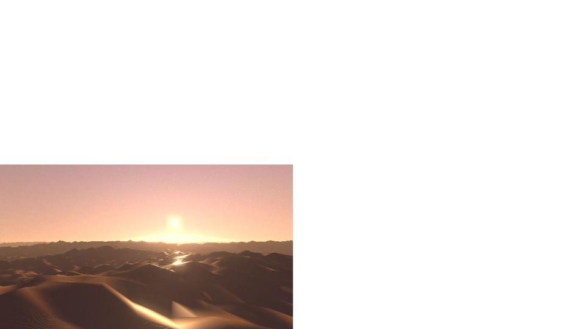

# Particles, snow and sand

Part of the [threers](../README.md) documentation.

`threers::particles` is a particle system with real physics in it: emitters,
gravity, air drag, wind and turbulence, collisions, and the layers of snow and
sand that particles settle into. The simulation runs on the CPU — the same on
every backend, and testable without a GPU — and draws as one instanced draw of
camera-facing quads. Falling weather that never lands runs on the GPU instead
([`Weather`](#weather-on-the-gpu)).


*`cargo run --release --example campfire`: everything in one frame.*


*`cargo run --release --example particles`: the presets.*

```rust
use threers::particles::{presets, ParticleAnimator};
use threers::prelude::*;

let mut scene = Scene::new();
let mut particles = ParticleAnimator::new();
let fire = particles.add(&mut scene, presets::fire(Vector3::ZERO, 0.3));
// Each frame:
particles.update(&mut scene, dt, Some(camera.position));
renderer.render(&mut scene, &camera);
```

## The physics

A particle falls under gravity and is pulled by the air through **quadratic
drag**, `k |u| u`, `u` being the air's velocity relative to it. `k` comes from
the particle's **terminal speed**, `k = g / v_t²`: the speed at which drag
balances its weight. That single number decides how a particle moves — a
snowflake (about 1 m/s) goes wherever the eddies take it, a sand grain (a few
m/s) or a raindrop (about 9 m/s) cuts straight through them, and a particle
with none (a spark, a fountain's water) flies ballistically.

The air is the **wind** plus **turbulence**: a sum of curls of plane waves, so
it is divergence-free (it never piles particles up or empties a region, which a
noise field that is not a curl does), eddies `scale` metres across, carried
downwind at the wind's speed and changing as they go by (`churn`). Drag is
integrated implicitly, so it is stable at any step and a falling particle
settles at exactly its terminal speed. **Attractors** pull toward a point;
**vortices** swirl the air round an axis.

Flame and smoke rise because they are lighter than air: their "gravity" points
up, and drag caps how fast they climb.

| | Terminal speed | Notes |
|---|---|---|
| Snowflake | 0.7–1.3 m/s | Carried by every eddy; spins as it falls |
| Sand grain | 3–5 m/s | Heavy; barely deflected |
| Raindrop | 8–9.5 m/s | Born at terminal speed; drawn as a streak |
| Smoke | 0.7–1 m/s (rising) | Buoyant; grows and fades |
| Dust | 0.35–0.6 m/s | Nearly neutrally buoyant; hangs |
| Spark | 14–22 m/s | Practically ballistic; bounces |

Tested in `src/particles/tests.rs`: a drag-free fall matches `g t` and
`g t² / 2`; drag settles on the terminal speed at steps up to half a second;
the turbulence's divergence is under 1% of its gradients; a flake dropped 5 m
in a 3 m/s wind drifts 15 m and a grain less than a third of that; a bounce returns `e²`
of the height.

## Emitters

An `Emitter` has a **shape** — a point, a ball (inside or on its surface), a
box, a disc, or a mesh's surface sampled by area — a **rate** and **bursts**, a
**direction** (outward from the shape, within a cone, or any), and ranges for
speed, lifetime, size, terminal speed and spin. Particles born during a frame
are spread over it rather than all at its start, so a stream is a stream and
not a string of beads one frame apart.

Over its life a particle's size follows a `Curve` and its colour and opacity a
`Gradient`: keys from 0 (born) to 1 (dies).

## Surfaces

`Collider::Ground`, `Sphere` and `Box`, and any `Heightfield` passed to
`step`. A particle that reaches one **bounces** (restitution, friction),
**sticks**, **dies**, or **deposits** — vanishes, handing its volume to the
heightfield.

## Drawing

`ParticleLook` picks a shape and a blend:

| `ParticleKind` | |
|---|---|
| `Billboard { softness }` | A disc facing the camera, its edge softened |
| `Streak { softness, shutter }` | Stretched along the motion across the view by the distance covered in `shutter` seconds: rain and sparks as a camera sees them |
| `Sphere` | A lit sphere impostor: grains, hail |
| `Distortion { strength }` | Bends the view of what is behind it: heat haze |

| `ParticleBlend` | |
|---|---|
| `Alpha` | Sorted back to front from the eye: smoke, snow, dust |
| `Additive` | Light added, no order needed: fire, sparks |
| `Opaque` | Solid and depth-written: sand |

`lit` shades them by the scene's lights and shadows (a flat particle is lit
from any side, as something small and thin scatters light; a sphere as a
sphere). Particles live in world coordinates; a `ParticleAnimator` moves each
system's emitters with its object, so a torch's fire follows the torch.

The rest of the look:

| `ParticleLook` | |
|---|---|
| `detail` | Billows: each particle broken up by noise of its own that drifts as it ages and thins it away, with the relief lighting it — smoke, flame, dust |
| `stretch` | Drawn out along the motion, as tongues of flame are |
| `scattering` | Henyey–Greenstein asymmetry: smoke and dust glow when the light is behind them (0.3–0.5), as they do |
| `self_shadow` | A billow darker on the side away from the light, by how much of it the light crosses |
| `flake` | Six-armed snowflakes, where they are big enough on screen to show it |
| `glint` | A tiny mirror on each particle at its own tilt: snow and sand sparkle as they turn |
| `casts_shadow` | Smoke and dust shadow the ground: a light-facing disc per particle, drawn only into the shadow maps, as dense as the particle is opaque |
| `intensity` | Emission scale, for additive flame and sparks |
| `extinction` | A particle is a sphere of medium: see below |
| `plates` | Flakes fall level: glints line up into pillars |
| `rainbow` | Drops send the sun back at a rainbow's angles |

A particle **receives** shadow as the little volume it is: four lookups across
it, at its own radius, give the share of it the light reaches — so one half
under a roof's edge is half lit, not cut by a hard line. And
`ParticleSystem::temperature_over_life` colours fire, embers and sparks by
their **black-body** temperature (Kelvin over life), brightness following
T⁴ — flame white-yellow at 1900 K, red as it cools through 1000 K.
`ParticleAnimator::light_with` hangs a point light at a fire's glowing centre,
its brightness following how much flame there is, so the light flickers with
the flames and casts the logs' shadows.

Each look compiles to its own pipeline, its settings constants in the
shader: nothing a look does not use costs anything per pixel, and sprites
too small on screen to show billows, arms or glints skip them.

`tests/particles.rs` checks that billboards stay round from any side, streaks
lie along the motion, a grain is lit from the sun's side, alpha particles sort,
additive ones add, smoke casts a shadow, and a particle half under a slab is
lit in between one under it and one in the open.

## Light through smoke

With `extinction` (per metre) set, a lit particle is a little sphere of
participating medium rather than a painted disc:

- **Opacity is Beer–Lambert's**, `1 − e^(−σ·chord)` along each line of sight
  through it, so a puff is as dense at any size or count.
- **Light reaching it is dimmed by the rest of the plume.** Each frame the
  system's particles are spread into a grid of extinction lined up with the
  sun, at most 32 cells a side. The optical depth down each column is then a
  running sum, and each particle reads the depth where the light enters it.
  The same is done toward the sky for the skylight. The underside of a plume
  is dark, its top bright.
- **Light scattered more than once fills in the shadowed side.** This uses
  Wrenninge's octaves (each with half the extinction, weight and asymmetry of
  the last) through a two-lobe Henyey–Greenstein phase. A plume's far side is
  dim but not black, and smoke glows against the sun.

The grid is fitted to all but the outermost 1% of particles, so one stray
spark doesn't coarsen it. It costs well under a millisecond for a few
thousand particles. `tests.rs` checks that the optical depth through a block
grows at the block's mean extinction from any direction. `tests/particles.rs`
checks that a column lit from above is dark at the foot and plain discs
aren't.

## Anisotropy

Light, surfaces and air that behave differently by direction:

- **Raindrops make a rainbow** (`rainbow`) where a sphere of water puts one:
  - the primary, red at 42.3° and violet at 40.6° from the point opposite
    the sun, bright inside;
  - Alexander's dark band;
  - the secondary, colours reversed, from 50.4° to 53.5°.

  A GPU test finds the red peak at 42° outside the blue, and the secondary
  reversed.
- **Flakes fall level** (`plates`): falling plate crystals settle broadside
  to the air, rocked a few degrees by their flutter. Their glints line up into
  a column under a low sun, the sub-sun, where randomly oriented facets make
  none.
- **Sand's sheen is stretched along the wind**: an anisotropic GGX lobe,
  rough across the ripples and smooth along their crests. Ripples too small
  to see become extra roughness along the wind. A GPU test measures it off
  the mirror direction, along against across.
- **Sand and snow are brighter seen down-sun**: the opposition surge of a
  granular surface (Hapke's `B₀ / (1 + tan(g/2)/h)`), which Lambert's law
  can't give.
- **Wind near the ground gusts mostly along itself** (`Turbulence::anisotropy`):
  eddies drawn out downwind and flattened by the ground. The spread of
  speeds comes out at the neutral surface layer's 2.5 : 1.9 : 1.25 (Panofsky
  & Dutton), and the flow is still divergence-free. A test checks both.

## Embers that burn

`ParticleSystem::thermal` gives each particle a temperature that follows
its heat balance:

- **Losses:** radiation `εσ(T⁴ − T_air⁴)`, and convection with the
  Ranz–Marshall correlation `Nu = 2 + 0.6 Re^½ Pr^⅓`, so moving air cools
  harder.
- **Gains:** burning char, the oxygen reaching the surface limited by
  diffusion and by an Arrhenius reaction rate in series.
- **Burning shrinks the grain** until it's ash. Come to rest on snow, it's
  quenched by contact.

`Thermal::ember` is charcoal. A 2 mm grain settles near 1290 K at rest, and
blown at 3 m/s it reaches 1700 K and burns three times faster. A warm grain
(600 K) doesn't catch, and one landing on snow goes dark in half a second.
Its glow is the black body's at its own temperature.

## Snow


*`cargo run --release --example snow`: a time-lapse at 7 s, 16 s and 50 s.*

`presets::snowfall` makes the flakes; a `SnowCover` keeps what lands. The
cover is a `Heightfield` over the scene whose base is found by casting rays
down (`base_from_scene`), so snow lies on roofs, crates and posts as well as
the ground. Each landing flake's snow is spread over a small disc — in a
time-lapse one drawn flake stands for many — and the layer **slumps** wherever
it is steeper than fresh snow holds (50°), so it slides off a roof's edge and
banks against the wall below. Thin snow lets the ground show through (`thin`),
and snow on a step in the base gets a skirt showing its depth.

Real snow falls a few centimetres an hour. `snowfall`'s `depth_per_second`
sets the pace. `SnowCover::drift` blows what lies downwind — scoured from the
open, banked in the lee of whatever stands in the wind — by the same slab
model as dunes. Drawn by its own shader: light carried a little way into the
snow, a fine grain to its surface, and glitter.

## Sand


*`cargo run --release --example sand`.*

Poured sand (`presets::sand_stream`) falls as grains and deposits into a
`SandBed`, which slumps to sand's **angle of repose**, 34°: the pile is a cone
at that angle whatever its size — a property of the material, not of how it
was poured. Slumping looks at sixteen neighbours (eight give an octagonal
pyramid) and moves material conservatively; `tests.rs` checks the pile's flank
stands within 3° of 34° and that volume is kept to a part in a thousand.

**Dunes** come from `SandBed::blow`: Werner's slab model (Werner, *Geology*
23, 1995). Slabs are lifted at random and carried downwind a hop at a time,
settling more readily on sand than on bare ground and always in the lee of a
slope steeper than 15°, with avalanches back to the angle of repose. From a
flat, patchy sheet it grows transverse ridges or crescent barchans, gentle on
the windward side and steep on the slip face, that migrate downwind — which
`tests.rs` checks of a single mound, along with its volume.

## Dunes




*`cargo run --release --example dunes`; in the browser, `web/examples/dunes.html`.*

`SandBed::dunes(DuneShape)` grows a dune field in two steps:

1. **A procedural field.** A network of sharp crests (the edges of Voronoi
   cells whose coordinates are pushed about by noise, so the crests curve)
   is drawn out across the wind into long transverse ridges. A broad flowing
   breakup goes over it, with smaller dunes on the big ones.
2. **Worked by the wind.** The slab model lifts sand off the windward slopes
   and drops it in the lee, with avalanches in between. Each dune ends up with
   a long gentle back and a slip face at the angle of repose. The field
   repeats, so the wind can carry sand around it.

`dunes::crests` finds the brinks, for `presets::spindrift` to blow sand off.

The sand is drawn after the sand in *Journey* (John Edwards' GDC 2013 talk,
and Alan Zucconi's write-up):

- each grain's normal tilted at random (nlerp);
- steep and shallow ripples blended by how level the surface is;
- a rim and an "ocean" specular, here the anisotropic sheen;
- threshold glitter;
- `stylize` for Journey's high-contrast diffuse with coloured shadows.

Underneath that is Oren–Nayar with the opposition surge, and sand streaking
up the windward faces.

`DesertTime` gives four times of day: `dawn`, `day`, `sunset`, `night`.
Its `sky_dome` brightens the horizon toward the sun by the same law the sand's
haze follows (`fog_glow`), so the dunes fade into the sky without a seam.

**No moiré.** Every procedural detail on the surface is band-limited by the
ground a pixel covers there: its distance over the projection, stretched by
`1/(n·v)` where the surface turns edge-on. This covers ripples, grains,
speckle, glints and streaks:

- a detail is drawn fully at 8 pixels a wavelength, and not at all by 3;
- the ripples' faded-out slope goes into the sheen's roughness;
- the ripples' sawtooth has rounded corners, since a hard step's harmonics
  would alias where the ripple itself is wide enough to draw.

## Weather on the GPU

`Weather::snow(count)` and `Weather::rain(count)` fill a box of air round the
camera with flakes or drops worked out in the vertex shader from each one's
index and the time — nothing simulated on the CPU, nothing uploaded per frame.
Falling weather needs no memory: a flake at terminal speed in a steady wind is
wherever its start and the time put it. Each falls at its own speed, carried
by the wind and swaying, wraps round the box as it leaves (fading at its faces
so nothing pops, and out near the eye) and is drawn by the particle shader, so
it is the same lit, glinting six-armed flake as a simulated one.

What it cannot do is land. For snow that piles up, pair it with a few
thousand simulated flakes settling on a `SnowCover`: the weather for what is
seen falling, the simulation for what lands. That is what the browser demo
does — 60,000 flakes on the GPU and 2,000 a second simulated.

```rust
let snow = particles.add_weather(&mut scene, Weather::snow(80_000));
// `ParticleAnimator::update` keeps its box over the eye.
```

## Speed

The simulation is single-threaded and allocation-free per step.
Slumping stops at a minimum move (a ten-thousandth of a cell), not at zero.
Below that, a quarter of the excess added to metres of sand is lost to
rounding, and a field would trickle without ever settling. A grown dune
field settles once, when it's made, and costs nothing after. Drag,
turbulence and collisions are a few dozen flops a particle; the air's velocity
is worked out every other step; the turbulence's cosines are a polynomial.
Snow covers and sand beds slump and redraw at 15 Hz (snow's mesh at 4 Hz), and
slumping looks only at the cells that moved and their neighbours, within a
budget of eight passes of the grid a frame — a dune field under a steady wind
always has slip faces avalanching somewhere, and spread over a few frames an
avalanche looks the same. Alpha particles are sorted by a counting sort on
depth, not a comparison sort.

`cargo run --release --example particles_bench` times the browser demo's two
scenes in thread CPU time. On an M-series Mac: the winter camp (2,000
simulated flakes a second settling and drifting on a 300 × 300 cover, and the
campfire) about 2.2 ms a frame; the desert (a pour onto a 220² bed and a
200² dune field under wind) about 3 ms. The browser's dunes demo
(a 300 × 300 bed and 6,000 puffs of spindrift) steps in under 4 ms of wasm
and draws at 60 fps on WebGPU and WebGL2 here. `-- draw` times drawing the winter
camp at 1280 × 720 with 4× MSAA, each piece left out in turn.

## Presets

| | |
|---|---|
| `fire(at, radius)` | Buoyant billowing tongues, additive, black-body coloured as they cool |
| `embers(at, radius)` | Glowing motes lofted by the fire |
| `heat_haze(at, radius)` | The view above a fire, shimmering |
| `smoke(at, radius)` | Rising, cooling and slowing, spreading; scattering, self-shadowed, casting a shadow |
| `sparks(at)` | Thrown in arcs, streaked, bouncing, cooling, spraying on impact |
| `rain(center, size, height, rate, wind)` | Drops at terminal speed, streaked |
| `snowfall(center, size, height, rate, depth_per_second, wind)` | Flakes that deposit |
| `sand_stream(at, rate, flow)` | Grains that deposit |
| `spindrift(crests, wind, rate, color)` | Sand smoking off dune crests |
| `dust(at, count)` | A puff that hangs and settles |
| `fountain(at, height)` | A jet `height` metres high, falling back |

Each is an ordinary `ParticleSystem`: change any field after making it.

## In the browser

```js
const cover = new THREE.SnowCover({ size: [20, 20], resolution: 300 });
scene.add(cover);
// Seen falling: on the GPU.
scene.add(new THREE.Weather('snow', 60000, { wind: [1, 0, 0.3] }));
// Landing: simulated.
const snow = new THREE.Particles('snowfall', {
  size: [22, 22], height: 6, rate: 2000, depthPerSecond: 0.0015,
  wind: [1, 0, 0.3], settleOn: cover,
});
scene.add(snow);
const fire = new THREE.Particles('fire', { radius: 0.3 });
fire.position.set(0, 0, 1);
scene.add(fire);
// The renderer steps them at every render.
```

`THREE.SandBed` takes `spread(depth, roughness)`, `shape(direction, slabs)`
and `blow(direction, slabsPerSecond)`; `THREE.SnowCover` takes
`drift(direction, slabsPerSecond)`; `Particles.lights(pointLight)` makes a
fire light the scene. Without the shim: `WebParticleSystem` and
`WebScene.addParticles` / `addSnowCover` / `addSandBed` / `createWeather` /
`settleParticles` / `lightParticles` / `stepParticles`.

```js
const bed = new THREE.SandBed({ size: [900, 900], resolution: 300, castFrom: 0 });
bed.dunes({ wavelength: 110, height: 14 });
const t = THREE.desertTime('sunset');
bed.look({ color: t.sand, shadowColor: t.shadow, fogGlow: t.glow, streaks: 1, stylize: 0.25 });
scene.add(bed);
scene.add(new THREE.Spindrift(bed, { wind: [9, 0, 1.5] }));
const sky = new THREE.DesertSky('sunset');
scene.add(sky); // and each frame: sky.position.copy(camera.position)
```

The demos are `web/examples/particles.html` (a winter camp, and
`?scene=desert`) and `web/examples/dunes.html`.
