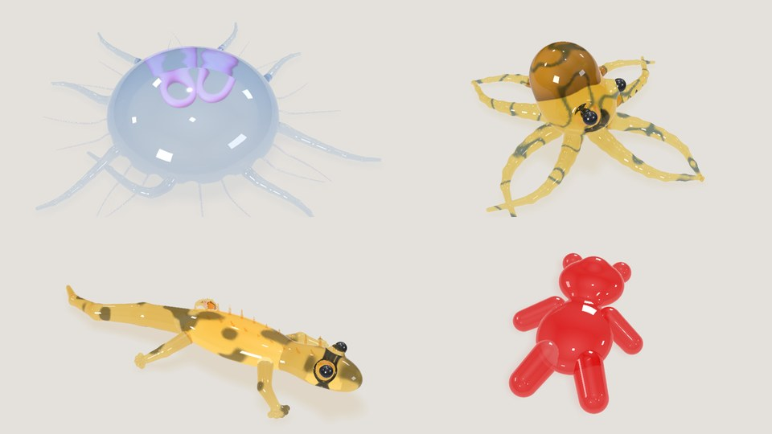

# Soft bodies that tear and grow back

Part of the [threers](../README.md) documentation.

`threers::softbody` simulates gummy creatures: a soft *body* with *parts*
glued on (tentacles, arms, a tail) that tear away when pulled and grow back
from the stump, *chains* of particles rooted in it (gills, fringes, crests),
and anything else bound to its lattice to ride along — a skin, eyes, sugar.
It is XPBD on tetrahedral lattices. In the browser it is `THREE.SoftBody`;
the demo is [`web/examples/jelly.html`](../web/examples/jelly.html).



## From shapes

Every body and part is a [`sdf::Shape`](sdf.md#fields-as-data-shape). Its skin
is meshed by surface nets, its lattice is cubes of side `h` over the field,
each split into five tetrahedra, and a part is glued to the body wherever it
reaches inside it.

```rust
use threers::math::Vector3;
use threers::sdf::Shape;
use threers::softbody::{ChainSpec, Creature, Marks, ShapeSpec};

let v = Vector3::new;
let body = ShapeSpec { shape: Shape::ellipsoid(v(0.3, 0.15, 0.3)).translate(v(0.0, 0.15, 0.0)), cell: 0.016, h: 0.07 };
let arm = ShapeSpec { shape: Shape::tapered_capsule(v(0.1, 0.1, 0.0), v(0.7, 0.03, 0.0), 0.06, 0.015), cell: 0.0095, h: 0.04 };
let marks = Marks {
    head: [[0.0, 0.25, 0.0], [0.2, 0.2, 0.0], [0.0, 0.2, 0.2]], // a frame the chains turn with
    span: [[0.3, 0.15, 0.0], [-0.3, 0.15, 0.0]],                 // the size readout
};
let creature = Creature::from_shapes(&body, &[("arm".into(), arm)], &[], marks)?;
let mut sim = creature.into_soft_body(7);
sim.step(1.0 / 60.0);
```

Everything sits on the table, `y >= 0`: the lattice starts there.

## Driving it

| | |
|---|---|
| `step(dt)` | One frame, in `params.substeps` substeps (12 at 60 Hz) |
| `start_grab(point, block)`, `grab.target`, `grab.angle` | A hand: the nodes near the point are pulled toward the target, turned about `grab.axis` |
| `tear_limit[i]` | How far part `i`'s glue stretches before a held part tears (0.07) |
| `muscles` | `Sway` — a travelling wave toward −x, the default; `Pulse` — each body edge shortens by `weight · pulse(t, phase, startle)`, a beat or a wave; `None` |
| `params` | `firmness`, `damping`, `regrow` (0..1), `substeps`, `gravity` |
| `walls` | Four planes the particles are kept inside — the edges of the screen |
| `raycast`, `measure`, `events` | Picking, the readouts, and what happened (tears, regrowth, goo landing) for sound |

Blocks: the particles live in one array cut into blocks — the body, then
three slots per part: the attached one, and two for torn-off copies, which
keep simulating and twitch. A tear copies the attached slot into a free one
and restarts it as a bud at 5 % size, its rest lengths and volumes scaled
back to 100 % with a little overshoot.

## Natively

`examples/gummy.rs` runs the jellyfish (or `--octopus`) natively, pulls a
tentacle off, and draws the frame with the wgpu renderer and, with
`--features metal`, the Metal renderer; `softbody::carry` moves its skins
with the lattice, as the browser's `carry` does.

## In the browser

`THREE.SoftBody` (a threers extension in the three.js shim) declares a
creature as data and runs it in wasm:

```js
const jelly = THREE.SoftBody.build({
    body: { field: bell, cell: 0.016, h: 0.07 },
    parts: [{ name: 'tentacle', field: tentacle }],
    chains: [{ points: [[0.6, 0.06, 0], [0.8, 0.02, 0]], r0: 0.009, r1: 0.004 }],
    head: [[0, 0.42, 0], [0.25, 0.36, 0], [0, 0.36, 0.25]],
    span: [[0.62, 0.07, 0], [-0.62, 0.07, 0]],
});
jelly.muscles = { weight: (mid, dir) => 1, pulse: { a: 0.09, omegaA: 4.7, powerA: 3 } };
jelly.step(1 / 60);

// drawing: a skin, carried along each frame
const skin = jelly.skin(0);                              // positions, normals, triangles at rest
jelly.carry(0, 0, positions, normals);                   // binding 0 is the body's skin; block 0 the body
const eyes = jelly.bind(0, eyePoints, eyeNormals);       // anything else, bound to the body's lattice
```

Skinning runs in Rust: each skin vertex follows the tetrahedron it lies in,
and its normal the cofactor of the deformation gradient there. Hands are
`raycast`, `grab`, `move`, `twist`, `release` (and `grabDrop`/`moveDrop`/
`releaseDrop` for the goo); readouts are `measure()`, `events()`, `blocks()`
and `held`.

## On the GPU

`softbody::gpu::GpuSolver` runs the substeps as WebGPU compute — integration,
the hand, edges, volumes and glue, the floor and walls, damping — and leaves
the rest (growth, muscles, chains, goo, tearing, the gradients skins follow)
to the CPU once a frame on positions read back:

```rust
let mut solver = GpuSolver::new(device, queue, &mut sim);
solver.step(&mut sim, 1.0 / 60.0);   // in place of sim.step
```

In the browser it is `body.useGpu(renderer)`, on the renderer's own device,
or `body.useGpuDevice(await THREE.SoftBody.requestComputeDevice())` on one of
its own — what a worker uses. The demo's Solver buttons pick Auto, CPU or
GPU (`g` cycles them; `?solver=auto|cpu|gpu` in the URL).

Gauss-Seidel solves one constraint after another, which a GPU cannot. The
lattice is a grid of cubes, and cubes whose grid coordinates are alike in
parity share no node — so the eight parity classes each run in parallel, a
thread a cube solving its own edges and then its five tetrahedra, one class
after another. Glue piles many links onto a few body nodes; a thread takes a
part node and its links, and the pull on the body is summed in fixed point
and applied after. That is fifteen dispatches a substep, where colouring
each constraint took 70 to 80. Two storage buffers (plus one for the glue's
sum), so it runs within WebGPU's downlevel limits.

It is the same physics in another order, so not the CPU solver's bit for
bit: `tests/softbody_gpu.rs` holds it to the same shapes (volume to four
figures, the body within 0.02 mm) and the same tears (a pulled tentacle comes
away at frame 39 against the CPU's 35). In a browser the positions arrive a
frame late; anything the CPU writes (a tear, a reset) is uploaded before the
next substeps, and an older readback is dropped.

| `examples/softbody_bench.rs -- --gpu`, Apple M4 Pro | CPU solver | GPU solver |
|---|---|---|
| jellyfish, 7,747 particles | 7.8 ms a step | 1.9 ms on the GPU, 0.4 ms on the CPU |
| octopus, 12,640 particles | 9.4 ms | 2.0 ms, 0.4 ms |

## Off the main thread

The demo runs the whole simulation in a worker: `web/examples/jelly-sim.js`
builds the creature, takes the hands' input and steps, and hands back each
frame as a snapshot of typed arrays — skins and normals already carried,
chains, goo, sugar, readouts — which `jelly-worker.js` posts across without
copying. The page asks for a frame and draws the newest snapshot it has,
never waiting; picking is a message, so a press resolves a moment later
(`jelly-client.js`; `?thread=main` puts it all back on the main thread).

| jellyfish, Chrome on WebGPU, a busy machine | main thread a frame | frames |
|---|---|---|
| CPU solver on the main thread | 36–38 ms | 26 fps |
| GPU solver on the main thread | 14 ms | 20–25 fps |
| CPU solver in the worker | 4–5 ms | 30–53 fps |
| GPU solver in the worker | 6 ms | 20–26 fps |

With the solver in a worker the CPU one already runs beside the drawing, and
the GPU solver's compute competes with the frame on the same GPU: which is
faster depends on the machine and the moment. So the demo's default solver is
*auto* (`jelly-sim.js`, `Autopilot`): it runs the CPU solver, tries the GPU
when that runs over 12 ms a step for a second, keeps it only if the page's
frame rate rises (by 5 %, or to 57 fps), and lets it go when its readbacks
fall three frames behind or the frame rate sags; each failed try doubles the
wait before the next, from 10 s to 80 s. Switching is cheap — the GPU solver
is suspended rather than dropped (`GpuSolver::suspend`/`resume`), so going
back to it is one upload — and loses nothing: `tests/softbody_gpu.rs` swaps
solvers every seven frames through a pull, and the tentacle still tears at
frame 39. The reason for the current choice shows under the solver buttons.

## Where it comes from

The solver is a port of Axolotl Jelly's by Dream Meridian
([github](https://github.com/saulfloresjr/axolotl-jelly), MIT), arithmetic for
arithmetic: f64 working values stored to f32 wherever the original stores into
a `Float32Array`, fdlibm for `Math.sin`/`exp`/`pow`, V8's own `Math.hypot`, and
insertion-ordered maps where the original's `Map`s are. `tests/softbody_parity.rs`
holds it to the JavaScript (kept in `tests/support/softbody/`): the lattice,
glue and landmarks node for node, and every particle, chain and drop through a
grab and a tear, bit for bit.

The lattice and solver are their own crate, `threers-softbody` (no GPU or
shape dependencies), so the wasm build can optimise them for speed inside a
package otherwise built for size: under `opt-level = "z"` a step took 50–80 ms
in the browser against 9 ms for the JavaScript; at `opt-level = 3` it takes
about 8.
