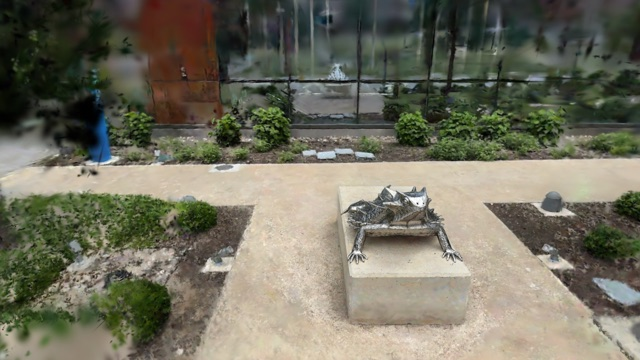

# Gaussian splats

Part of the [threers](../README.md) documentation.

`threers::splats` draws 3D Gaussian splats — scenes captured as millions of
coloured, translucent ellipsoids rather than triangles (Kerbl et al., *3D
Gaussian Splatting for Real-Time Radiance Field Rendering*, SIGGRAPH 2023) —
in the scene alongside everything else, on WebGPU, WebGL2, native wgpu and
the Metal renderer. It is behind the opt-in `splats` feature.

| | |
|---|---|
|  |  |

<sub>Niantic's `.spz` samples (`hornedlizard.spz`, `racoonfamily.spz`, MIT, from
[nianticlabs/spz](https://github.com/nianticlabs/spz)) in `web/splats.html` on
WebGPU.</sub>

```rust
use threers::prelude::*;
use threers::splats::{splat_object, GaussianSplats, SplatOptions};

let splats = GaussianSplats::from_bytes(&std::fs::read("scene.spz")?)?;
let mut scene = Scene::new();
let (object, mut sorter) = splat_object(&splats, &SplatOptions::default())?;
let id = scene.add(object);

// Where to look from: close for a captured scene, all in view for an object.
let (centre, distance) = splats.framing();
let mut camera = PerspectiveCamera::new(50.0, 16.0 / 9.0, distance * 0.003, distance * 500.0);
camera.position = centre + Vector3::new(0.0, 0.15, 1.0).normalize() * distance;
camera.look_at(centre);

// Once a frame, before rendering: back to front for this camera.
sorter.update(&mut scene, id, &camera);
```

## Files

| Format | Reader | Notes |
|---|---|---|
| PLY from the reference trainer | `from_ply` (and `to_ply`) | ASCII or binary of either endianness; spherical harmonics to degree 3 |
| Compressed PLY (SuperSplat, PlayCanvas) | `from_ply` | 256-splat chunks of quantised attributes, decoded as `splat-transform` decodes them |
| Niantic `.spz` | `from_spz` | Versions 1–4: gzip through the crate's own inflate, version 4's zstd through the pure-Rust `ruzstd`; degree-4 harmonics are cut to 3 |
| `.splat` | `from_splat` (and `to_splat`) | 32 bytes a splat, no view-dependent colour |

`from_bytes` picks the reader from a file's first bytes. Files keep their own
axes: trainers write `y` down, so turn a PLY or `.splat` over about `x`
(`object.set_rotation_from_axis_angle(Vector3::new(1.0, 0.0, 0.0), PI)`);
`.spz` is stored `y` up already. The readers are checked against files the
reference tools wrote — splat-transform's `.spz` fixtures (written by the
reference library), Niantic's own samples, and one capture PlayCanvas ships
as both `.spz` and compressed PLY, which decode to the same splats.

## Drawing

Each splat is projected as the reference rasteriser projects it — the 3D
covariance through the camera's local affine approximation (EWA splatting),
plus a 0.3 px² low-pass — and drawn as a quad reaching only as far as the
splat stays visible: three standard deviations for an opaque one, less for a
faint one, nothing for one that never reaches 1/255. View-dependent colour
(spherical harmonics to degree 3) is evaluated in the splats' own frame, so
the object's transform applies. Splats are depth-tested against opaque
meshes, and `.spz` files trained with Mip-Splatting's antialiasing are drawn
with its opacity compensation.

Against a CPU port of the reference rasteriser's forward pass
(`compare_with_the_reference_rasteriser` in `tests/splats.rs`, given a file),
the GPU picture is within 56 dB PSNR on mostly matte captures and 39 dB on a
shiny one. What is left is colours past 1, which a straight-alpha blend
clamps where the reference lets them add.

## Sorting

Blending needs the splats back to front. `SplatSorter::update` sorts on the
CPU whenever the view direction turns, and uploads only the order. The sort
is its own crate, [`threers-splat-sort`](../crates/threers-splat-sort): a
radix sort over 24-bit depth keys made in SIMD-shaped loops, about 2.5 ms a
million splats natively and 5 in the browser. It is a crate of its own so the
size-optimised wasm profile can still compile it for speed; build the web
package with `SIMD=1` for its keys in `simd128`.

## In the browser

From JavaScript, `scene.addSplats(bytes)` takes a file's bytes, any format;
every `renderer.render(...)` sorts for its camera. `scene.splatFrame(handle)`
gives `[x, y, z, distance]` to aim a camera, `scene.splatCount()` the total.

[`web/splats.html`](../web/splats.html) is a viewer: open a file, drop it on
the page, or link it with `?src=`. Drag to orbit, scroll to zoom. It adapts
its render scale to hold 30+ fps. `?backend=gl` forces WebGL2, `?scale=`
pins the scale, `?bench=<frames>` times an orbit (`&still=1` the GPU alone),
and `?cam=x,y,z,tx,ty,tz` fixes the camera.

```sh
SPLATS=1 WEBGL=1 SIMD=1 ./web/build.sh
python3 -m http.server -d web 8000   # then open /splats.html
```

WebGPU needs a secure context: from another machine over plain HTTP the page
runs on WebGL2.

## Limits and speed

The splats live in a `ShaderMaterial`'s storage, 16 floats a splat: up to
about 2.1 million at wgpu's default 128 MiB binding, and 2²⁴ in any case.
On WebGL2 the data comes from a float texture 2048 texels wide, read four
floats at a time (`s0x4`).

Measured in Chrome on an M4 Pro, a million splats: about 5 ms of CPU a frame
while the view turns, none while it is still; 18–24 ms a frame on WebGPU and
23–30 ms on WebGL2 at one pixel per CSS pixel, from close inside the scene.
`examples/splats.rs` renders a file (or a generated million) and, with
`SPLATS_BENCH=<frames>`, times the sort and the frame.
