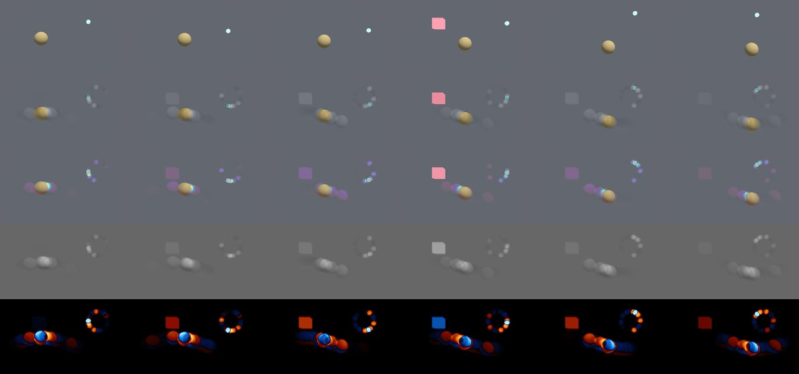
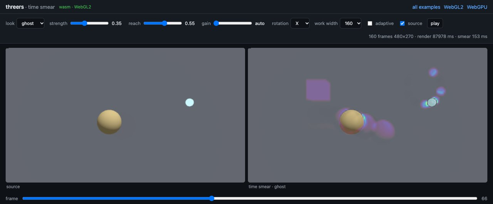

# Time smear

Part of the [threers](../README.md) documentation.

`threers::time_smear` gives every moving thing in a clip echoes of itself at
other moments in time, before it arrives as well as after it has gone.
Anything that never moves comes back exactly as it was. It is an offline
filter over a sequence of RGBA frames, and runs the same natively and in wasm.
In the browser it is `THREE.TimeSmear`, and the demo is
[`web/examples/time-smear.html`](../web/examples/time-smear.html).



*Rows: source, faithful, ghost, raw, echo. The pink box is only on screen for
frames 70–85 (fourth column), but its echo is already there at 56 and 66.*

## What it does

Motion blur, trails and afterimages only smear light forwards: frame `t` can
reach `t + 1, t + 2, …`. The time smear sends each pixel's brightness over a
64-frame window through a small interference transform instead. The echoes
land at specific frames on both sides of the event, spaced by the bits of a
Gray code rather than spread smoothly.

For one pixel's 64 luma values `v[t]`:

1. They become amplitudes `sqrt(v[t] / Σv)` on six qubits, addressed by the
   Gray code of `t`, so neighbouring frames differ in one bit.
2. Qubit `k` is turned by `θₖ = π·strength·((1 − reach)·W₀[k] + reach)`. At
   `reach = 0` the low bits (nearby frames) turn most and the echoes stay
   close. At `reach = 1` all six turn alike and the echoes jump far.
3. The probabilities, scaled back by `Σv`, are the new brightness.

Three properties follow, and the tests check each of them:

- Light is moved in time, never created: each window keeps its total.
- A constant pixel is a fixed point, so a still background comes back
  bit-identical.
- It is not linear: smearing `a + b` is not the sum of smearing each.

Only luma is smeared, at a reduced working width (160 px by default). The
*echo* (smeared minus source) is upsampled and added to the full-resolution
frame, so edges and text come from the source and only the ghost layer is
soft. Clips of any length run as 64-frame windows that hop by 32, crossfaded
with `sin²` weights that sum to one. Clips shorter than 64 frames are padded
with their last frame.

## Natively

```rust
use threers::time_smear::{SmearLook, TimeSmear};

let smear = TimeSmear::new()
    .strength(0.35)   // 0 is the identity
    .reach(0.55)      // 0 near echoes, 1 far
    .look(SmearLook::Ghost);

// A clip in memory: RGBA8 frames, width × height each.
let out: Vec<Vec<u8>> = smear.apply(&frames, width, height);
```

Streaming wraps any frame closure, such as a renderer or a decoder, and plugs
straight into the exporters:

```rust,ignore
let frame = smear.wrap(width, height, n, |i| {
    pose(&mut scene, i);
    renderer.render_to_rgba(&mut scene, &camera)
});
threers::export_video(width, height, n, &opts, frame)?; // `video` feature
```

`wrap` must be called with `0, 1, 2, …` in order, which is what
`export_video`, `VideoExporter` and `render_sequence` do. It renders up to 63
frames ahead of what it returns and holds those source frames in memory:
about 0.5 GB at 1080p, a quarter of that at 540p.

For your own compositing, `echo_volume(&luma, w, h)` returns only the echo of
a luma volume (`[frames][h][w]`), and `smear_column` transforms a single
64-frame history.

| Setting | Default | |
|---|---|---|
| `strength` | 0.3 | How far each qubit turns; 0 leaves the clip alone |
| `reach` | 0.55 | Near echoes (0) to far ones (1) |
| `rotation` | `X` | `X`, `Y`, `XY`, `YX`: which rotations each qubit gets. `X` carries a quarter-turn phase, so its echoes interfere differently from `Y`'s |
| `work_width` | 160 | Width the luma is smeared at. Higher is sharper ghosts and more work |
| `look` | `Faithful` | See below |
| `gain` | per look | Echo gain: 1 faithful, 3 ghost, 4 echo |
| `dark` | 0.25 | Ghost look: how much removed light darkens the source |
| `adaptive` | off | `Adaptive { motion_ref, floor }`: scale strength and reach per 36 px tile by how much it moves, so busy regions can be pushed hard without ghosting calm ones |

### Looks

| Look | Shows |
|---|---|
| `Faithful` | The source plus its own echo, added equally to R, G and B. No invented colour: hue survives and grey stays grey |
| `Ghost` | Added light as an iridescent glow, removed light as a darkening |
| `Raw` | The smeared luma alone, in grey |
| `Echo` | Only the echo: warm where light was added, cool where it was taken, black where nothing changed |

The echo is computed on Rec. 709 luma of the *encoded* values, not on linear
light. This is deliberate: it is the model the look was tuned on, and a
static pixel must come back unchanged byte for byte.

### Backends

The filter is CPU code and never touches the GPU, so it works with whatever
drew the frames. [`examples/time_smear.rs`](../examples/time_smear.rs)
renders the shot above and writes the sheet:

```text
cargo run --release --example time_smear                          # wgpu
cargo run --release --example time_smear --features metal -- --metal
cargo run --release --example time_smear --features video         # + one MP4 per look
```

Both renderers give the same backdrop value, `(100, 103, 112)`, and the same
echoes. With `parallel`, compositing and each window's transform spread over
rayon. There is one parallel call per 32 frames, not one per pixel.

## In the browser

```js
import THREE, { initThreers } from 'threers';

const smear = await THREE.TimeSmear.capture(renderer, scene, camera, {
    frames: 160,
    update: (i) => pose(i),   // move things before frame i is drawn
});
smear.set({ strength: 0.35, reach: 0.55, rotation: 'x', workWidth: 160, adaptive: false });
ctx.putImageData(smear.imageData(i, 'ghost'), 0, 0);  // or smear.frame(i, look, gain) for RGBA bytes
```

`capture` renders the clip into an **sRGB** render target with 4× MSAA and
reads it back. A plain `WebGLRenderTarget` stores linear light, as in three.js,
and reads back too dark: `(32, 35, 41)` where the screen shows
`(100, 103, 112)`. To smear frames you already have, use
`new THREE.TimeSmear(width, height, frames)`, where `frames` is an array of
RGBA8 buffers or one buffer holding them back to back, or `push(rgba)` them
one at a time.

Everything except the capture is Rust (`WebTimeSmear` in `src/wasm`). That
includes the clip, the option parsing, look and rotation names, the smearing
and the compositing. The capture stays in the shim because it has to go
through the JavaScript renderer.

| Method | |
|---|---|
| `set({ strength, reach, rotation, workWidth, adaptive, dark })` | Change any of them and re-smear; returns milliseconds. `rotation` is `'x'`, `'y'`, `'xy'` or `'yx'`; `adaptive` is a bool or `{ motionRef, floor }` |
| `params()` | The current settings, as `set` takes them |
| `frame(i, look, gain)` | RGBA8 bytes. `look`: `'faithful'` (default), `'ghost'`, `'raw'`, `'echo'`, `'source'` |
| `imageData(i, look, gain)` | The same as an `ImageData`, for `putImageData` |
| `push(rgba)` | Append a frame; the next frame asked for re-smears |

`set()` re-smears the whole clip: 40–110 ms for 160 frames of 480×270 at the
default work width in Chrome, in the size-tuned wasm build. The first call
also takes the clip's luma. Looks and gain only change how a
frame is composited, so switching them during playback costs one frame.

The demo, [`web/examples/time-smear.html`](../web/examples/time-smear.html),
has live controls for every setting and a frame scrubber. `?gl=1` forces
WebGL2. It was checked in Chrome on WebGPU and on WebGL2: the same pixel
values as native, the backdrop byte-identical after smearing, and the box's
echo present before it appears.



*The browser demo (here on WebGL2) at frame 66. The source has no box yet,
but the smeared frame already shows its ghost.*

## Limits

- It needs the future, so it is not a live post pass. A live version would
  have to delay the picture by a window (about a second at 60 fps) or give up
  the echoes that come before the event.
- Window seams are softened, not removed. A frame's place in its 64-frame
  window sets its Gray-code address and so its echo pattern. Near a window
  boundary roughly a tenth of an echo spills into the neighbouring window.
- Ghosts are as soft as the working width. Raising it costs memory and time
  in proportion to the pixel count.

## Where it comes from

The model is the "quantum time-smear" of
[eps696/mothionblur](https://github.com/eps696/mothionblur) (Moth Hack 2026).
That project runs the transform as jobs on Moth's Atlas quantum platform, and
reproduces it locally with NumPy and Qiskit. threers implements the local
model: its fitted per-qubit weights, Gray-code addressing, `sin²` windowing
and looks. It does not implement the project's two other Atlas engines (a
spatial blur and an audio echo). The transform here is checked against an
independent dense 64×64 unitary built from the same definition, to 1e-9.
